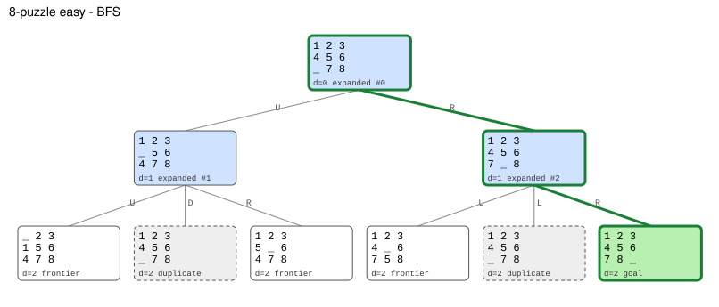
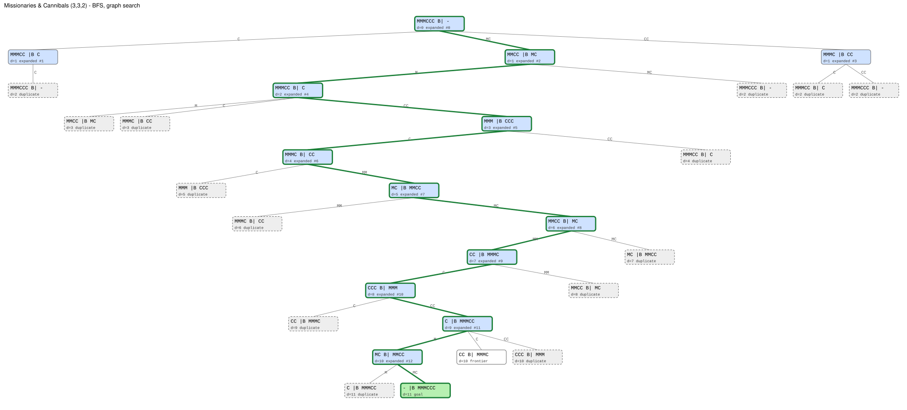
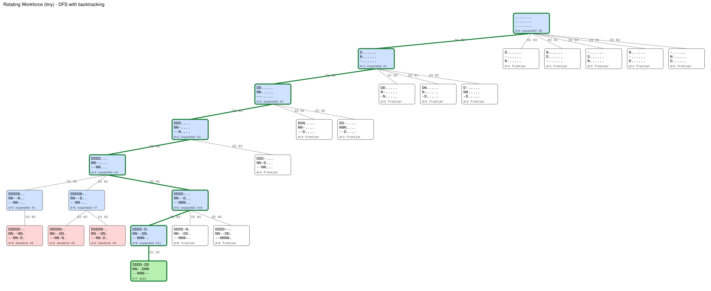

<!-- This file is generated from the four <part>/report.md files; edit those and rebuild with: python report/build_report.py -->
# Uninformed Search Techniques — Raporti i përbashkët

**Lënda:** Inteligjenca Artificiale
**Autore:** lizesyla
**Gjuha e implementimit:** Python 3 (vetëm biblioteka standarde; ndërfaqet grafike përdorin `tkinter`)
**Kodi:** https://github.com/lizesyla/Artificial_Intelligence-26-lizesyla

Ky dokument bashkon raportet e katër pjesëve të projektit. Çdo pjesë ka edhe raportin e vet në dosjen përkatëse (`<pjesa>/report.md`). Ai raport mbetet burimi kryesor; ky skedar krijohet duke i bashkuar ata.

## Përmbajtja

| Pjesa | Problemi | Algoritmi i kërkuar | Dosja |
|---|---|---|---|
| 1 | Social Golfers Problem (32 golfistë, 8 grupe me 4) | DFS me Backtracking | `social_golfers/` |
| 2 | Sudoku Solver (Easy, Medium, Hard) | BFS me Backtracking | `sudoku_solver/` |
| 3 | Latin Square (hyrja n → katror n × n) | IDDFS dhe Backtracking | `latin_square/` |
| 4 | Search Trees: 8-Puzzle, Missionaries and Cannibals, Rotating Workforce Scheduling | BFS, DFS, DLS, IDDFS, UCS | `search_trees/` |
| 5 | Krahasimi i pjesëve dhe përfundimi i përgjithshëm | — | ky dokument |

Për secilin problem, raporti përmban:

- modelimin dhe reprezentimin (gjendja, variablat, domenet, kufizimet);
- funksionin objektiv;
- llogaritjen e landscape-it (madhësia e hapësirës së kërkimit);
- implementimin e algoritmit të kërkuar;
- metodologjinë e testimit;
- rezultatet e matura dhe kompleksitetin.

**Si janë marrë rezultatet:** të gjitha rezultatet janë nga ekzekutime reale të programeve dhe ruhen në dosjet `results/`. Ku një kërkim u ndal nga limiti i kohës ose i nyjeve, kjo shënohet si `LIMIT_REACHED` dhe nuk interpretohet si vërtetim.


---

## Pjesa 1 — Social Golfers Problem me DFS dhe Backtracking

**Lënda:** Inteligjenca Artificiale — Uninformed Search Techniques
**Gjuha e implementimit:** Python 3 (`social_golfers.py`)
**Algoritmi:** Depth-First Search (DFS) me Backtracking

---

### 1. Modelimi i problemit

Kemi **N = 32** golfistë që luajnë një herë në javë, të ndarë në **G = 8** grupe me nga **S = 4** golfistë (N = G · S). Kërkohet një orar (*schedule*) për **W** javë ku asnjë çift golfistësh nuk luan në të njëjtin grup më shumë se një herë.

Problemi njihet në literaturë si instanca **8-4-W** e *Social Golfer Problem* (CSPLib prob010). Ai mund të shikohet në dy mënyra:

- **Problem vendimi (decision problem):** për një W të dhënë, a ekziston një orar i vlefshëm me W javë? Këtë e zgjidh drejtpërdrejt DFS-i.
- **Problem optimizimi:** cili është W maksimal? Kjo kërkon dy gjëra të ndryshme: (a) të gjendet një orar me W javë, dhe (b) të vërtetohet që W + 1 javë janë të pamundura.

Implementimi është i parametrizuar: `--groups G --size S --weeks W`. Për testim fillojmë me instancën e vogël **8 golfistë, 2 grupe me 4** (8-2-4) dhe pastaj kalojmë te instanca e plotë 32-8-4.

**Supozimet:**

1. Të gjithë golfistët luajnë çdo javë (asnjë mungesë).
2. Golfistët shënohen me numrat 1…N; emrat nuk kanë rëndësi.
3. Një grup është bashkësi (*set*): rendi brenda grupit nuk ka rëndësi.
4. Rendi i grupeve brenda javës nuk ka rëndësi.
5. Rendi i javëve nuk ndikon në vlefshmërinë e orarit.

---

### 2. Gjendja fillestare, gjendja qëllim dhe hapësira e gjendjeve

Orari paraqitet si tabelë me **W · N vende bosh (*slots*)**: java 1 ka N vende të ndara në G grupe me S vende, pastaj java 2, etj.

- **State (gjendja):** një orar pjesërisht i plotësuar — vendet 0 … k−1 janë të mbushura, pjesa tjetër bosh. Thellësia e gjendjes është k.
- **Initial state (gjendja fillestare):** k = 0, të gjitha vendet bosh.
- **Action / operator:** vendos një golfist në vendin e radhës k (nëse nuk shkel kufizimet).
- **Goal state (gjendja qëllim):** k = W · N, pra të gjitha vendet janë mbushur dhe të gjitha kufizimet plotësohen.
- **State space:** të gjitha oraret e pjesshme të vlefshme që mund të arrihen nga gjendja fillestare. Thellësia maksimale e pemës është **d = W · N** (për 32-8-4 me W = 10 kjo është 320).

Shembull i një gjendjeje (W = 2, k = 10) për 8-2-4:

```
Java 1: [1 2 3 4] [5 6 7 8]
Java 2: [1 5 _ _] [_ _ _ _]
```

---

### 3. Variablat dhe domenet

Si problem me kufizime (CSP):

| Variabli | Kuptimi | Domeni |
|---|---|---|
| x(w, g, p) | golfisti në javën w, grupin g, pozicionin p | {1, …, N} |

me w ∈ {1..W}, g ∈ {1..G}, p ∈ {1..S}. Gjithsej ka **W · G · S = W · N** variabla.

Domeni efektiv gjatë kërkimit është më i vogël, sepse golfistët e përdorur tashmë në javën w përjashtohen. Në kod, variablat ndihmëse janë:

| Struktura në kod | Kuptimi |
|---|---|
| `schedule[w][g]` | lista e golfistëve në grupin g të javës w |
| `used[w]` | bit mask: cilët golfistë janë vendosur tashmë në javën w |
| `met[x]` | bit mask: me cilët golfistë ka luajtur x deri tani (*pair tracker*) |

---

### 4. Kufizimet (constraints)

- **C1 — Numri i grupeve:** çdo javë ka saktësisht G grupe.
- **C2 — Madhësia e grupit:** çdo grup ka saktësisht S golfistë.
- **C3 — Mbulimi (coverage):** çdo golfist shfaqet saktësisht një herë në çdo javë. Kjo do të thotë që grupet e një jave janë disjunkte dhe bashkimi i tyre është {1, …, N}.
- **C4 — Çiftet unike:** për çdo çift golfistësh {a, b}, numri i javëve ku a dhe b janë në të njëjtin grup është ≤ 1.

Gjatë DFS-it, C1, C2 dhe C3 plotësohen **nga ndërtimi**: çdo javë ka saktësisht N vende të ndara në G grupe me S, dhe një golfist i përdorur në javën w nuk ofrohet më si kandidat në atë javë. C4 kontrollohet në çdo vendosje:

```
kandidati c pranohet  ⇔  met[c] AND mask(grupi aktual) == 0
```

Funksioni `validate_schedule()` i kontrollon të katër kufizimet **në mënyrë të pavarur** nga solver-i, që gabimet e solver-it të mos fshihen. Ai kontrollon edhe numrin e javëve dhe që numrat e golfistëve janë në intervalin 1…N.

---

### 5. Funksioni objektiv

Për problemin e optimizimit:

```
maksimizo W
në kushtet C1–C4 për çdo javë 1..W
```

Për një W të fiksuar, DFS-i zgjidh një problem kënaqshmërie (*satisfiability*) që ka vetëm dy përgjigje: ekziston ose nuk ekziston. Opsioni `--find-max` ekzekuton DFS për W = 1, 2, 3, … dhe ndalon te W i parë që nuk gjendet.

**Kufiri i sipërm (upper bound).** Në çdo javë, një golfist takon S − 1 golfistë të rinj. Ai ka gjithsej N − 1 golfistë të tjerë për të takuar, prandaj:

```
W · (S − 1) ≤ N − 1   ⇒   W ≤ ⌊(N − 1)/(S − 1)⌋
```

Për 32-8-4: W ≤ ⌊31/3⌋ = **10**. (Numërimi i çifteve jep kufi më të dobët: C(32,2)/(8·C(4,2)) = 496/48 ≈ 10.33, pra prapë 10.) Ky kufi është **kusht i nevojshëm, jo i mjaftueshëm**. Për shembull, për 8-2-4 kufiri jep 2, por maksimumi i vërtetë është 1 (shih seksionin 9).

**Çfarë dihet nga literatura:** për 32-8-4 ekziston një orar me 10 javë. Atë e ndërtoi në mënyrë eksplicite Alejandro Aguado në vitin 2004, me konstruksion matematikor dhe jo me kërkim të painformuar. Meqë 10 është edhe kufiri i sipërm, maksimumi është **10**. Ky fakt vjen nga literatura (Wikipedia, "Social golfer problem"; CSPLib prob010) dhe **nuk** është vërtetuar nga programi ynë.

---

### 6. Hapësira e kërkimit dhe search landscape

Duhet të dallojmë tre nivele numërimi. Shënojmë P = numri i ndarjeve javore.

**(a) Numri i grupeve të mundshme** (nënbashkësi me S nga N):

```
C(N, S) = C(32, 4) = 35 960
```

**(b) Numri i ndarjeve javore** (N golfistë në G grupe të parenditura me S):

```
P = N! / ( (S!)^G · G! ) = 32! / ( (4!)^8 · 8! )
  = 59 287 247 761 257 140 625 ≈ 5.93 × 10^19
```

Faktori (S!)^G heq renditjet brenda grupeve, dhe G! heq renditjet e grupeve. Kontroll: për 4 golfistë në 2×2, P = 3; për 8-2-4, P = 35; për 9-3-3, P = 280. Formula verifikohet me numërim të plotë në testin `test_partition_count_by_enumeration`.

**(c) Numri i orareve me W javë** (pa kufizimin C4):

| Supozim | Formula | W = 5 | W = 10 |
|---|---|---|---|
| Javët të renditura, mund të përsëriten | P^W | ≈ 7.3 × 10^98 | ≈ 5.4 × 10^197 |
| Javët të ndryshme, pa renditje | C(P, W) | ≈ 6.1 × 10^96 | ≈ 1.5 × 10^191 |

Kufizimi C4 e zvogëlon shumë numrin e orareve të vlefshme, por nuk ka formulë të njohur të mbyllur për to.

**Pema e DFS-it.** Pa simetri, faktori i degëzimit në vendin k është ≤ numri i golfistëve të lirë të javës (≤ N), dhe thellësia është W · N. Një javë pa kufizime gjeneron deri në N! = 32! ≈ 2.6 × 10^35 rrugë. Ky numër është (S!)^G · G! ≈ 4.4 × 10^15 herë më i madh se P, sepse e njëjta javë ndërtohet në shumë renditje.

**Thyerja e simetrive (symmetry breaking).** Përdorim katër rregulla. Secila heq vetëm degë që janë kopje pasqyrë të degëve të tjera, prandaj asnjë zgjidhje reale nuk humbet:

| Rregulli | Simetria që hiqet | Implementimi |
|---|---|---|
| S1 | rendi brenda grupit | golfistët në grup vendosen në rend rritës |
| S2 | rendi i grupeve në javë | çdo grup fillon me golfistin më të vogël të lirë |
| S3 | emrat e golfistëve (N!) | java 1 fiksohet: {1..4}, {5..8}, …, {29..32} |
| S4 | rendi i javëve 2..W | partneri i golfistit 1 rritet nga java në javë |

Me S1 dhe S2, çdo ndarje javore ndërtohet saktësisht një herë. Prandaj numri i javëve të plota që mund të ndërtohen në çdo nivel është ≤ P, dhe jo ≤ N!.

**Peizazhi (landscape).** Për një problem kënaqshmërie, peizazhi nuk ka "lartësi" të vazhdueshme: një gjendje ose shkel kufizimet ose jo. Karakteristikat kryesore janë:

- **Plato të gjera:** shumë orare të pjesshme të vlefshme duken njësoj "të mira" për një kërkim të painformuar.
- **Rrugë qorre të thella (deep dead ends):** një prefiks i vlefshëm me k javë mund të jetë i pamundur për t'u zgjeruar. Kjo shihet vetëm shumë nivele më poshtë. Shembulli konkret i gjetur nga programi ynë: me renditje rritëse, DFS-i ndërton 5 javë ku golfistët 1–16 kanë takuar vetëm njëri-tjetrin, dhe golfistët 17–32 vetëm njëri-tjetrin. Në javën 6, çdo grup do të duhej të kishte ≤ 1 golfist nga secila gjysmë, pra madhësia e grupit do të ishte ≤ 2 < 4. Pra prefiksi është i pashpëtueshëm, por DFS-i kronologjik e provon këtë duke rikthyer pafund në nivelet e javëve 5 dhe 6 (*thrashing*).
- **Dendësia e zgjidhjeve bie shpejt me W:** për W të vogla ka shumë zgjidhje, ndaj DFS-i gjen njërën pothuajse pa backtracking. Afër W = 10 zgjidhjet janë shumë të rralla.

---

### 7. DFS me Backtracking

DFS-i zgjeron gjithmonë nyjen më të thellë. Implementimi është rekursiv, ku stack-u i rekursionit Python është stack-u LIFO i DFS-it:

```
dfs(k):
    nëse k == W·N:  kthe SUKSES                       # goal test
    (w, g, p) = vendi k
    për çdo kandidat x (në rend fiks, ose të përzier me seed):
        nëse x shkel C4 me grupin aktual:  vazhdo     # pruning
        vendos x                                       # shko më thellë
        nëse dfs(k+1):  kthe SUKSES
        hiq x                                          # BACKTRACK
    kthe DËSHTIM                                       # rrugë qorre
```

**Si funksionon *pair tracker*-i.** `met[x]` është një numër i plotë ku biti y = 1 nëse x dhe y kanë qenë bashkë në grup. Kontrolli i C4 kërkon vetëm një veprim AND. Kur vendosim x, ndezim bitet për çiftet e reja; kur bëjmë backtrack, i fikim. Fikja është e sigurt sepse, në një gjendje të vlefshme, çdo çift është takuar të shumtën një herë.

**Kriteret e ndalimit dhe raportimi.** Kërkimi ka tri përfundime të mundshme:

| Status | Kuptimi |
|---|---|
| `FOUND` | u gjet një orar me W javë; ai validohet më pas në mënyrë të pavarur |
| `NO_SOLUTION` | e gjithë pema u eksplorua: **u vërtetua** që W javë janë të pamundura |
| `LIMIT_REACHED` | u arrit `--max-nodes` ose `--time-limit`: **asgjë nuk vërtetohet** |

**Optimizimet dhe pse nuk e ndryshojnë strategjinë.** Përdorim tri optimizime:

1. Bit masks për kontrollin e çifteve, që e bën kontrollin më të shpejtë pa ndryshuar pemën.
2. Symmetry breaking (S1–S4), që heq vetëm degë ekuivalente.
3. Opsionin `--random --seed`, që ndryshon vetëm rendin e fëmijëve. Rendi i fëmijëve nuk ndryshon strategjinë: është prapë DFS i plotë dhe i rregullt, sepse çdo nyje vizitohet të shumtën një herë dhe pema kalohet e gjitha nëse nuk ka limit.

Nuk përdoret asnjë heuristikë, greedy, restart apo local search. Rregullat e simetrisë mund të çaktivizohen me `--no-symmetry` për krahasim.

---

### 8. Metodologjia e testimit

**Teste automatike** (`python social_golfers.py --test`, 20 teste me `unittest`):

- **Validimi — orare të vlefshme:** 4 golfistë me 3 javë (çdo çift saktësisht një herë); një javë e vlefshme me 32 golfistë.
- **Validimi — orare të pavlefshme:** çift i përsëritur, golfist që mungon ose përsëritet në javë, grup me madhësi të gabuar, numër i gabuar grupesh, numër golfisti jashtë intervalit, numër i gabuar javësh.
- **Matematika:** C(32,4) = 35 960; P për 4, 8, 9 dhe 32 golfistë; kufiri i sipërm; formula e P verifikohet me numërim të plotë për 6 golfistë (P = 15).
- **Solver-i:** çdo orar i gjetur kalon nëpër `validate_schedule()`. Instancat me përgjigje të njohur janë: 8-2-4 (1 javë po, 2 jo), 4-2-2 (3 po, 4 jo), 9-3-3 Kirkman (4 po, 5 jo), si edhe 32-8-4 me 1 javë. Testohet edhe raportimi i `LIMIT_REACHED` dhe që opsionet `--no-symmetry` dhe `--random` japin orare të vlefshme.

**Eksperimentet:** çdo ekzekutim me `--save` shkruan tre lloje skedarësh në `results/`:

- `results/<instanca>_<koha>.txt` — output-i i plotë;
- `results/runs.csv` — një rresht për çdo kërkim (status, nodes, backtracks, sekonda, versioni i Python);
- `results/schedule_..._W<k>_<koha>.json` — orari i gjetur, i cili mund të ri-validohet.

**Metrikat:**

- **nodes** = numri i vendosjeve të pranuara, pra gjendjet e gjeneruara;
- **backtracks** = numri i vendosjeve të hequra;
- **max depth** = vendi më i thellë i arritur;
- **koha** matet me `time.perf_counter()`.

Numri i nyjeve është deterministik për një konfigurim dhe seed të dhënë. Koha varet nga kompjuteri.

#### 8.1 Ndërfaqja grafike (`ui_golfers.py`)

Për ta parë kërkimin hap pas hapi, projekti ka edhe një ndërfaqe grafike me `tkinter` (`python ui_golfers.py`). Ajo **nuk** ka algoritëm të veçantë. Klasa `SteppingDFS` trashëgon `SocialGolfersDFS` dhe e shkruan `_dfs()` rekursiv si cikël me stack eksplicit, që ndalon pas çdo ngjarjeje: *assign*, *reject*, *dead end* dhe *backtrack*.

Komanda `python ui_golfers.py --selftest` verifikon që versioni vizual dhe solver-i japin **saktësisht** të njëjtin status, numër nyjesh, numër backtracks dhe të njëjtin orar në 11 raste. Këto përfshijnë 8-2-4 pa simetri (1 722 400 nyje), 32-8-4 me W = 6 dhe seed 0 (8 293 nyje), si edhe një rast me limit.

Çfarë tregon dritarja:

- **Orari (grid):**
  - një rresht për çdo javë dhe një kuti për çdo grup;
  - ngjyra e golfistit është ngjyra e grupit të tij në javën 1, kështu që duket si përzihen golfistët nga java në javë;
  - korniza e verdhë tregon vendin që DFS-i po mbush;
  - numri i kuq është kandidati i refuzuar;
  - korniza portokalli tregon golfistin e hequr nga backtracking.
- **Matrica e çifteve (pair tracker):** qeliza (a, b) ngjyroset me javën kur a dhe b kanë luajtur bashkë. Çifti që shkaktoi refuzimin e fundit shfaqet me të kuqe.
- **Numëruesit:** nodes, backtracks, kandidatë të refuzuar, thellësia, javë të plota, çifte të përdorura dhe kufiri i sipërm.
- **Log-u:** shpjegon me fjalë çdo hap të DFS-it.

Ndërfaqja e bën të dukshme rrugën qorre të seksionit 6. Me renditje rritëse për 32-8-4 dhe W = 6, matrica ka dy blloqe 16 × 16 plotësisht të mbushura, pra golfistët 1–16 dhe 17–32 kanë takuar vetëm njëri-tjetrin. Ndërkohë, DFS-i rikthehet vazhdimisht në javët 5–6.

Koha e matur në UI përjashton vizatimin dhe pauzat, por është prapë më e ngadaltë se solver-i. Për matjet zyrtare përdoret `social_golfers.py`.

---

### 9. Rezultatet dhe interpretimi

> **Burimi i të dhënave:** këto janë rezultate **të ekzekutimit real**, të marra më 24.10.2026 me Python 3.10.12 në Linux. Ato janë të ruajtura në `results/runs.csv`. Kur ekzekuton programin në kompjuterin tënd, numri i nyjeve për rastet `FOUND`/`NO_SOLUTION` duhet të jetë i njëjtë, ndërsa kohët do të ndryshojnë. Për rastet `LIMIT_REACHED`, edhe numri i nyjeve varet nga shpejtësia e kompjuterit.

#### 9.1 Instancat e vogla dhe efekti i simetrisë

| Instanca | W | Simetri | Status | Nodes | Koha (s) |
|---|---|---|---|---|---|
| 8-2-4 | 1 | po | FOUND | 8 | 0.0000 |
| 8-2-4 | 2 | po | NO_SOLUTION | 13 | 0.0001 |
| 8-2-4 | 2 | jo | NO_SOLUTION | 1 722 400 | 7.44 |
| 9-3-3 | 4 | po | FOUND | 37 | 0.0002 |
| 9-3-3 | 5 | po | NO_SOLUTION | 958 | 0.0039 |
| 9-3-3 | 5 | jo | LIMIT_REACHED (30 s) | 7 663 616 | 30.0 |
| 16-4-4 | 5 | po | FOUND | 80 | 0.0004 |

**Interpretimi:**

- **8-2-4: maksimumi = 1 javë, i vërtetuar.** Për 2 javë, DFS-i eksploroi gjithë pemën dhe nuk gjeti zgjidhje. Arsyeja matematikore: pas javës 1, çdo grup i ri me 4 do të përmbante të paktën 2 golfistë nga i njëjti grup i vjetër (parimi i Dirichlet-it). Shembulli tregon që kufiri ⌊7/3⌋ = 2 nuk arrihet gjithmonë.
- **9-3-3: maksimumi = 4.** Kjo është e vërtetuar sepse 4 = kufiri i sipërm.
- **Efekti i simetrisë:** për të vërtetuar të njëjtin fakt, DFS-i pa simetri kërkoi 1 722 400 nyje (8-2-4) në vend të 13, dhe për 9-3-3 me 5 javë nuk mbaroi as për 30 s.
- **16-4-4:** u gjetën 5 javë, që është kufiri ⌊15/3⌋.

#### 9.2 Instanca e plotë 32-8-4

Komanda e përdorur:

```
python social_golfers.py --groups 8 --size 4 --find-max --time-limit 60 --max-nodes 0
```

Ky është kërkim me renditje rritëse:

| W | Status | Nodes | Backtracks | Koha (s) |
|---|---|---|---|---|
| 1 | FOUND | 32 | 0 | 0.0002 |
| 2 | FOUND | 64 | 0 | 0.0004 |
| 3 | FOUND | 96 | 0 | 0.0005 |
| 4 | FOUND | 128 | 0 | 0.0007 |
| 5 | FOUND | 160 | 0 | 0.0009 |
| 6 | LIMIT_REACHED (60 s) | 9 973 760 | 9 973 609 | 60.0 |

Kërkimi me renditje të përzier të fëmijëve (`--random --seed s`, prapë DFS):

| W | Seed | Limit | Status | Nodes | Thellësia max (javë të plota) |
|---|---|---|---|---|---|
| 6 | 0 | 25 s | **FOUND** | 8 293 | 6 |
| 6 | 1 | 25 s | LIMIT_REACHED | 4 273 152 | 4 |
| 6 | 2 | 25 s | LIMIT_REACHED | 4 407 296 | 4 |
| 6 | 3 | 25 s | LIMIT_REACHED | 4 219 904 | 5 |
| 6 | 4 | 25 s | LIMIT_REACHED | 4 155 392 | 5 |
| 7 | 0 | 60 s | LIMIT_REACHED | 9 306 112 | 6 |
| 7 | 1 | 60 s | LIMIT_REACHED | 10 418 176 | 4 |

Orari me 6 javë (seed 0), i validuar nga `validate_schedule()` pa asnjë gabim:

```
Java 1: [ 1  2  3  4] [ 5  6  7  8] [ 9 10 11 12] [13 14 15 16] [17 18 19 20] [21 22 23 24] [25 26 27 28] [29 30 31 32]
Java 2: [ 1  5 10 18] [ 2 20 28 29] [ 3 16 25 32] [ 4 24 26 30] [ 6 14 17 31] [ 7 12 13 21] [ 8 11 19 22] [ 9 15 23 27]
Java 3: [ 1 17 26 29] [ 2 10 15 31] [ 3 22 27 30] [ 4  9 16 18] [ 5 14 19 21] [ 6 12 20 23] [ 7 11 28 32] [ 8 13 24 25]
Java 4: [ 1 19 28 30] [ 2 21 26 32] [ 3 18 24 29] [ 4 10 22 25] [ 5 13 23 31] [ 6 11 16 27] [ 7  9 14 20] [ 8 12 15 17]
Java 5: [ 1 20 24 27] [ 2 14 18 23] [ 3 12 19 26] [ 4  5 11 29] [ 6 13 22 32] [ 7 15 25 30] [ 8  9 28 31] [10 16 17 21]
Java 6: [ 1 21 25 31] [ 2  7 19 27] [ 3 10 23 28] [ 4  8 14 32] [ 5  9 17 24] [ 6 15 18 26] [11 13 20 30] [12 16 22 29]
```

**Interpretimi:**

1. DFS-i ynë **gjeti orare të vlefshme me 1–6 javë** për 32 golfistë. Kjo tregon vetëm që 6 javë janë **të mundshme**. Nuk tregon që 6 është maksimumi; në fakt dihet nga literatura që maksimumi është 10.
2. Për W = 6 me renditje rritëse dhe për W = 7, kërkimi u ndal nga limiti. Status `LIMIT_REACHED` **nuk** do të thotë që zgjidhja nuk ekziston.
3. Kërkimi me renditje rritëse ngec për shkak të rrugës qorre të përshkruar në seksionin 6: prefiksi me 5 javë është i pashpëtueshëm, por DFS-i kronologjik e eksploron atë nyje pas nyje.
4. Rendi i fëmijëve ndikon shumë në kohën e DFS-it: seed 0 gjeti 6 javë për 0.06 s, ndërsa seed-et 1–4 nuk i gjetën për 25 s. Kjo është tipike për kërkimin e painformuar.
5. Programi **nuk** vërtetoi maksimumin për 32-8-4. Përfundimi korrekt është: *maksimumi ≥ 6 (nga programi), ≤ 10 (nga kufiri), dhe = 10 sipas literaturës*.

---

### 10. Kompleksiteti kohor dhe hapësinor

Shënojmë **b** = faktori i degëzimit (≤ N) dhe **d** = W · N = thellësia e pemës.

- **Koha, rasti më i keq:** O(b^d) nyje, pra O(N^{W·N}). Me simetri, numri i javëve të plota të ndërtuara në çdo nivel është ≤ P, kështu që kufiri bëhet afërsisht O(P^{W−1}), pasi java 1 është e fiksuar. Kjo mbetet eksponenciale në W.
- **Kosto për nyje:** O(N) për listën e kandidatëve dhe O(S) për kontrollin e çifteve me bit masks.
- **Hapësira:** DFS ruan vetëm rrugën aktuale:
  - stack-u i rekursionit ka thellësi O(W · N);
  - orari ka W · N numra;
  - `met[]` ka N maska me N bit secila, pra O(N²) bit.

  Gjithsej O(W · N + N²). Për 32-8-4 me W = 10, kjo do të thotë rreth 320 nivele rekursioni, që është shumë pak memorie. Kjo është përparësia kryesore e DFS-it ndaj BFS-it, i cili do të duhej të ruante një nivel të tërë të pemës.
- **Kompletësia:** DFS-i është i plotë për këtë problem, sepse pema është e fundme (thellësia e kufizuar) dhe asnjë zgjidhje nuk hiqet nga simetria. Pra, pa limit, ai ose gjen zgjidhje ose vërteton `NO_SOLUTION`. Në praktikë, për 32-8-4 me W ≥ 6, limiti i kohës arrihet shumë më herët.
- **Optimaliteti:** "optimal" këtu nuk ka kuptim për një W të fiksuar, sepse çdo zgjidhje është e barabartë me të tjerat. Për W maksimal, optimaliteti vërtetohet vetëm me `NO_SOLUTION` për W + 1 ose me arritjen e kufirit të sipërm.

---

### 11. Kufizimet dhe përfundimi

**Kufizimet:**

- DFS-i kronologjik bën backtrack vetëm një nivel në një kohë. Ai nuk e "kupton" që shkaku i dështimit ndodhet shumë javë më lart, prandaj ka *thrashing* në rrugë qorre të thella.
- Programi gjen ≤ 6 javë për 32-8-4 brenda kufijve të kohës që provuam. 10 javët e njohura janë gjetur me konstruksione matematikore ose me metoda më të avancuara (constraint propagation, local search), të cilat dalin jashtë kërkimit të painformuar.
- Rezultatet me `--random` varen nga seed-i. Një ekzekutim i vetëm nuk është përfaqësues për të gjithë seed-et.
- Kohët janë matur në një kompjuter të vetëm. Ato duhet të rimaten në mjedisin e studentit.
- Symmetry breaking (S3, S4) është i saktë për problemin e plotë, por e bën orarin e gjetur të duket "i normalizuar": java 1 është gjithmonë {1..4}, {5..8}, ….

**Përfundimi:**

Implementuam DFS me Backtracking për Social Golfers Problem, me kontroll të kufizimeve në çdo hap, *pair tracking* me bit masks, thyerje të simetrive që nuk humbet zgjidhje, kufij kërkimi dhe raportim të ndershëm të tri statuseve. Testet automatike verifikojnë si validimin ashtu edhe solver-in në instanca me përgjigje të njohur. Për instancat e vogla, DFS-i **vërteton** maksimumin (8-2-4 → 1, 9-3-3 → 4). Për instancën e plotë 32-8-4, DFS-i gjen orare të vlefshme deri në **6 javë**, por **nuk** arrin të vërtetojë maksimumin. Kjo tregon qartë kufizimin kryesor të kërkimit të painformuar: hapësira rritet si P^W me P ≈ 5.93 × 10^19, dhe pa informacion shtesë ose propagim kufizimesh, DFS-i nuk mund ta mbulojë atë në kohë praktike.

---

### Referenca

- Wikipedia, "Social golfer problem": https://en.wikipedia.org/wiki/Social_golfer_problem
- CSPLib, Problem 010 — Social Golfers Problem: https://www.csplib.org/Problems/prob010/
- M. Triska, "The Social Golfer Problem": https://www.metalevel.at/sgp/


---

## Pjesa 2 — Sudoku Solver me BFS dhe Backtracking

**Lënda:** Inteligjenca Artificiale — Uninformed Search Techniques
**Skedarët:**

| Skedari | Përmbajtja |
|---|---|
| `sudoku_solver.py` | algoritmi, validimi, gjeneratori i niveleve, 19 teste |
| `ui_sudoku.py` | vizualizimi me tkinter |
| `results/` | rezultatet e ekzekutimeve |

**Kërkesa e detyrës:** programi zgjidh Sudoku në tri nivele (Easy, Medium, Hard) me *Breadth First Search (BFS) me Backtracking*.

---

### 1. Modelimi i problemit

Sudoku standard është një grid 9 × 9, i ndarë në 9 kuti 3 × 3. Disa qeliza janë të dhëna (*givens*). Duhet të mbushen qelizat bosh me shifrat 1–9 ashtu që çdo rresht, çdo kolonë dhe çdo kuti të përmbajë secilën shifër saktësisht një herë.

Implementimi është i përgjithësuar për n = R · C ≤ 9, me kuti R × C: 4 × 4 (kuti 2 × 2), 6 × 6 (kuti 2 × 3) dhe 9 × 9 (kuti 3 × 3). Kështu algoritmi mund të testohet fillimisht në instanca të vogla.

**Nivelet (Easy / Medium / Hard).** Niveli përcaktohet nga numri i shifrave të dhëna: më pak shifra do të thotë më shumë qeliza bosh, pra pemë kërkimi më e thellë dhe më e gjerë.

| Niveli | Shifra të dhëna | Qeliza bosh E | Puzzle i integruar |
|---|---|---|---|
| Easy | 38 | 43 | `--level easy` |
| Medium | 30 | 51 | `--level medium` |
| Hard | 24 | 57 | `--level hard` |

Të tre puzzle-t janë krijuar nga gjeneratori i programit me seed të fiksuar (`generate('easy', seed=1)`, `generate('medium', 2)`, `generate('hard', 2)`). Testet verifikojnë që secili ka **saktësisht një zgjidhje**.

**Si punon gjeneratori:**

1. Ndërton një grid të plotë të rastësishëm. Nis nga një model i vlefshëm dhe përdor vetëm lëvizje që e ruajnë vlefshmërinë: përzien rreshtat brenda një bande, përzien bandat, përzien kolonat brenda një shtylle, përzien shtyllat dhe riemërton shifrat.
2. Heq shifra në rend të rastësishëm, por vetëm kur puzzle-i mbetet me zgjidhje unike.

Me `--generate hard --seed 7` krijohen puzzle të reja. Për krahasim, programi përmban edhe puzzle të njohura: "AI Escargot" (23 shifra), një puzzle me 17 shifra, një puzzle pa zgjidhje dhe një puzzle të pavlefshëm.

> **Shënim:** numri i shifrave të dhëna është tregues i thjeshtë i vështirësisë. Faqet e Sudoku (p.sh. sudoku-space.com) zakonisht e matin vështirësinë sipas teknikave logjike që kërkohen. Në seksionin 9 tregohet që, për BFS-in tonë, nivelet tona japin vërtet përpjekje kërkimi gjithnjë e më të madhe.

---

### 2. Reprezentimi i problemit

**State (gjendja):** një grid i pjesshëm, i ruajtur si `bytes` me n² vlera (0 = bosh). Ky reprezentim është i vogël, rreth 120 bajt për 9 × 9, gjë që ka rëndësi sepse BFS ruan shumë gjendje njëkohësisht.

- **Initial state:** puzzle-i i dhënë.
- **Action / successor function** (`expand`):
  1. zgjidh **një** qelizë bosh me një rregull të fiksuar;
  2. për çdo shifër d që **nuk** shfaqet në rreshtin, kolonën apo kutinë e saj, krijo një fëmijë me d në atë qelizë.
- **Rregulli i zgjedhjes së qelizës:**
  - `first` (parazgjedhja): qeliza e parë bosh sipas renditjes së leximit. Ky rregull është plotësisht i painformuar.
  - `mrv` (*minimum remaining values*): qeliza me më pak shifra të lejuara. Ky është një heuristikë e renditjes së variablave dhe përdoret vetëm për krahasim.
- **Goal state:** asnjë qelizë bosh. Meqë asnjë shifër e paligjshme nuk vendoset kurrë, çdo grid i plotë i arritur është zgjidhje.
- **Thellësia e zgjidhjes:** çdo veprim shton saktësisht një shifër, prandaj **të gjitha** zgjidhjet ndodhen në thellësinë E = numri i qelizave bosh.

**Pse pema nuk ka gjendje të përsëritura:** çdo gjendje zgjedh qelizën në mënyrë deterministike, kështu që çdo gjendje ka një rrugë unike nga rrënja. Prandaj nuk nevojitet bashkësi `visited`. Kjo vlen si për `first` ashtu edhe për `mrv`.

---

### 3. Variablat, domenet dhe kufizimet

| Elementi | Përkufizimi |
|---|---|
| Variablat | x_i për çdo qelizë bosh i (E variabla) |
| Domeni | D(x_i) = {1, …, n}; për 9 × 9: {1, …, 9} |
| Domeni efektiv | shifrat që nuk shfaqen te "fqinjët" (*peers*) e qelizës: 20 qeliza në 9 × 9 |
| Kufizimet | **AllDifferent** për 27 njësi (9 rreshta, 9 kolona, 9 kuti); shifrat e dhëna nuk ndryshohen |

Kufizimet mund të shkruhen edhe si çifte: x_i ≠ x_j për çdo i, j në të njëjtën njësi. Për 9 × 9 ka 810 çifte të tilla.

---

### 4. Funksioni objektiv

Përkufizojmë numrin e konflikteve të një gridi G:

```
f(G) = numri i çifteve (i, j) në të njëjtën njësi me G[i] = G[j] ≠ 0
```

Qëllimi është:

```
gjej G të plotë (pa qeliza bosh) me f(G) = 0      ⇔   min f = 0 dhe 0 qeliza bosh
```

Në BFS-in tonë, f mbahet **gjithmonë 0**, sepse çdo fëmijë kontrollohet para se të krijohet. Prandaj qëllimi reduktohet në: *arrij thellësinë E*. Funksioni `validate_solution()` e kontrollon këtë në mënyrë të pavarur: grid i plotë, çdo njësi është permutacion i 1..n, dhe shifrat e dhëna janë ruajtur.

---

### 5. Landscape — madhësia e hapësirës së kërkimit

E = numri i qelizave bosh.

| Madhësia | Formula | Easy (E=43) | Medium (E=51) | Hard (E=57) |
|---|---|---|---|---|
| Plotësime naive | 9^E | 1.1 × 10^41 | 4.6 × 10^48 | 2.5 × 10^54 |
| Kufiri i pemës pa krasitje | Σ_{k=0}^{E} 9^k | 1.2 × 10^41 | 5.2 × 10^48 | 2.8 × 10^54 |
| Prodhimi i domeneve efektive në fillim | Π \|D(x_i)\| | 4.0 × 10^17 | 2.5 × 10^24 | 1.0 × 10^32 |
| Gjendje të gjeneruara realisht nga BFS (`first`) | e matur | 1 856 | 7 558 | 215 177 |
| Zgjidhje | — | 1 | 1 | 1 |

Disa numra referimi:

- Numri i gridëve të plotë të vlefshëm 9 × 9 është 6 670 903 752 021 072 936 960 ≈ 6.67 × 10^21 (Felgenhauer & Jarvis, 2005).
- Për 4 × 4 ka 288 gride të plota. Testi `test_empty4_has_288_solutions` e verifikon këtë me BFS.

**Interpretimi i peizazhit:**

- **Struktura:** peizazhi është një pemë me thellësi fikse E. Të gjitha gjethet e vlefshme (zgjidhjet) janë në fund, dhe në rastin e puzzle-ve me zgjidhje unike ka vetëm **një** gjethe të tillë.
- **Rrugët qorre:** shumica e degëve mbarojnë më herët, sepse një qelizë nuk ka asnjë shifër të ligjshme. Për Hard, 61 997 nga 215 176 gjendjet e zgjeruara ishin rrugë qorre.
- **Profili sipas thellësisë:** numri i gjendjeve për çdo thellësi nuk rritet në mënyrë monotone. Ai rritet kur qelizat e radhës kanë shumë opsione dhe bie kur kufizimet "kafshojnë". Për Hard, maksimumi ishte 40 713 gjendje në thellësinë 34, pastaj ra deri në 1 në thellësitë 49–57. Grafiku "States generated per depth" në UI e tregon këtë profil.

---

### 6. BFS me Backtracking

```
BFS(puzzle):
    frontier = FIFO queue me [puzzle]
    ndërsa frontier nuk është bosh:
        s = frontier.pop_front()                     # gjendja më e cekët
        (qeliza, shifrat) = zgjidh_qelizë(s)         # rregull i fiksuar
        nëse shifrat == ∅:  rrugë qorre → hidhet     # BACKTRACK
        për çdo d në shifrat (rend rritës):          # vetëm shifra të ligjshme
            fëmija = s me d në qelizë
            nëse fëmija është i plotë:  ZGJIDHJE (goal test kur gjenerohet)
            përndryshe:  frontier.push_back(fëmija)
    asnjë zgjidhje → NO_SOLUTION
```

**Ku është "backtracking"-u në BFS?** BFS nuk kthehet mbrapa në kuptimin rekursiv, sepse nuk ka stack thirrjesh. Ai përdor dy elementet thelbësore të metodës së backtracking-ut:

1. **Kontrolli i konsistencës para zgjerimit:** një shifër që shkel rregullat nuk shtohet kurrë, kështu që e gjithë nën-pema e saj prerët menjëherë.
2. **Braktisja e kandidatëve të pjesshëm:** kur një gjendje nuk ka asnjë vazhdim të ligjshëm (rrugë qorre), ajo hidhet dhe kërkimi vazhdon me gjendjen tjetër në radhë.

Ndryshimi i vetëm nga backtracking-u klasik (DFS) është **rendi**: radha FIFO e eksploron pemën nivel pas niveli. Programi lejon edhe `--algorithm dfs` (stack LIFO me të njëjtin funksion `expand`), por vetëm për krahasim.

**Statuset:**

| Status | Kuptimi |
|---|---|
| `SOLVED` | u gjet zgjidhje; me `--all` numërohen të gjitha zgjidhjet dhe vërtetohet uniciteti |
| `NO_SOLUTION` | e gjithë pema u eksplorua dhe nuk ka zgjidhje |
| `LIMIT_REACHED` | u arrit kufiri i nyjeve, i madhësisë së radhës ose i kohës; asgjë nuk vërtetohet |
| `INVALID_PUZZLE` | shifrat e dhëna shkelin rregullat |

---

### 7. Kompleksiteti

Shënojmë b = faktori maksimal i degëzimit (≤ n) dhe d = E.

| | BFS | DFS (krahasim) |
|---|---|---|
| Koha (rasti më i keq) | O(b^d) | O(b^d) |
| Memoria | O(b^d) — e gjithë radha e një niveli | O(b · d) — vetëm rruga aktuale |
| Kompletësia | po (pema është e fundme) | po |
| Gjen zgjidhjen e parë | vetëm pasi ka gjeneruar **të gjitha** nivelet më të cekëta | sapo arrin në fund të një dege të mirë |

Ka edhe një vëzhgim të rëndësishëm, që vërtetohet nga testi `test_bfs_levels_are_in_order`. Në Sudoku të gjitha zgjidhjet janë në të njëjtën thellësi E, prandaj BFS **nuk mund të ndalojë herët**: para se të gjejë zgjidhjen e parë, ai duhet të gjenerojë çdo gjendje të vlefshme në thellësitë 0 … E−1. Për puzzle-t me zgjidhje unike, BFS praktikisht bën kërkim të plotë.

Kur numërohen **të gjitha** zgjidhjet (`--all`), BFS dhe DFS eksplorojnë **saktësisht të njëjtën pemë**: kanë të njëjtin numër gjendjesh dhe të njëjtin profil sipas thellësisë (testi `test_bfs_and_dfs_agree`). Ndryshon vetëm memoria.

Kostoja për një zgjerim është O(n²) me rregullin `mrv` dhe O(peers) = O(n) me `first`.

---

### 8. Metodologjia e testimit

**Testet automatike** (`python sudoku_solver.py --test`, 19 teste):

- **Gjeometria:** çdo qelizë ka 20 / 12 / 7 fqinjë në 9×9 / 6×6 / 4×4. Leximi i gridit refuzon gjatësi të gabuar dhe shifra jashtë intervalit.
- **Validimi:** puzzle me shifra të përsëritura → `INVALID_PUZZLE`; zgjidhje e saktë → pa gabime; zgjidhje me shifra të ndërruara, jo e plotë, ose me shifër të dhënë të ndryshuar → gabim.
- **Nivelet:** Easy / Medium / Hard kanë 38 / 30 / 24 shifra të dhëna, zgjidhje unike dhe zgjidhen nga BFS. Ato përputhen me gjeneratorin (seed 1, 2, 2). Gridet e rastësishme janë të vlefshme për 4×4, 6×6 dhe 9×9, dhe puzzle-t e gjeneruara kanë zgjidhje unike.
- **Kërkimi:**
  - 4×4, 6×6 dhe 9×9 me zgjidhje unike;
  - grid bosh 4×4 → saktësisht 288 zgjidhje të ndryshme;
  - BFS = DFS për pemën e plotë;
  - BFS gjeneron të gjitha nivelet para zgjidhjes;
  - puzzle pa zgjidhje → `NO_SOLUTION`;
  - limiti raportohet si `LIMIT_REACHED`;
  - një grid tashmë i zgjidhur pranohet.

**Vizualizimi** (`python ui_sudoku.py --selftest`) krahason versionin hap-pas-hapi me `solve()` në 90 kombinime: puzzle × BFS/DFS × `first`/`mrv` × zgjidhja e parë/të gjitha, plus limitet. Të gjitha numëruesit dalin identikë.

**Matjet:** ekzekutimet me `--save` shkruajnë `results/*.txt` dhe një rresht në `results/runs.csv`. Opsioni `--memory` mat memorien maksimale me `tracemalloc`; ai e ngadalëson programin, prandaj koha e matur me të nuk krahasohet me kohët e tjera.

---

### 9. Rezultatet

> **Burimi i të dhënave:** të gjitha vlerat janë nga ekzekutime reale më 29.10.2026, me Python 3.10.12 (Linux), të ruajtura në `results/`. Numri i gjendjeve është deterministik dhe duhet të dalë i njëjtë në çdo kompjuter; koha ndryshon.

#### 9.1 Tri nivelet me BFS (rregulli `first`, zgjidhja e parë)

| Niveli | Shifra | E | Status | Gjenerohen | Rrugë qorre | Radha max | Koha (s) | Memoria max* |
|---|---|---|---|---|---|---|---|---|
| Easy | 38 | 43 | SOLVED | 1 856 | 524 | 302 | 0.006 | 0.08 MB |
| Medium | 30 | 51 | SOLVED | 7 558 | 2 192 | 793 | 0.029 | 0.18 MB |
| Hard | 24 | 57 | SOLVED | 215 177 | 61 997 | 41 328 | 0.79 | 9.71 MB |

\* Memoria është matur me `--memory`. Për krahasim, DFS kërkoi 0.01 MB në të tri nivelet.

Zgjidhja e Hard, e validuar si VALID:

```
2 3 5 | 7 4 6 | 1 8 9
9 8 1 | 3 2 5 | 6 7 4
4 7 6 | 8 9 1 | 5 3 2
------+-------+------
7 5 4 | 6 8 9 | 2 1 3
8 6 9 | 1 3 2 | 4 5 7
3 1 2 | 5 7 4 | 9 6 8
------+-------+------
5 4 8 | 9 1 3 | 7 2 6
6 2 7 | 4 5 8 | 3 9 1
1 9 3 | 2 6 7 | 8 4 5
```

#### 9.2 BFS kundrejt DFS dhe `first` kundrejt `mrv`

Kolona "Gjenerohen" tregon numrin e gjendjeve të gjeneruara; "radha max" është madhësia maksimale e radhës (BFS) ose e stack-ut (DFS).

| Puzzle | BFS first (të gjitha) | DFS first (të gjitha) | BFS first (e para) | DFS first (e para) | BFS mrv (të gjitha) |
|---|---|---|---|---|---|
| Easy | 1 856 / radha max 302 | 1 856 / 13 | 1 856 | 1 488 | 44 / 1 |
| Medium | 7 558 / 793 | 7 558 / 23 | 7 558 | 855 | 77 / 3 |
| Hard | 215 177 / 41 328 | 215 177 / 33 | 215 177 | 42 001 | 87 / 5 |
| AI Escargot | 18 885 / 1 716 | 18 885 / 20 | 18 885 | 8 987 | 2 232 / 93 |
| 17 shifra | LIMIT (5 M) / 1 628 479 | LIMIT (5 M) / 46 | LIMIT | LIMIT | 73 483 / 5 210 |
| Pa zgjidhje | NO_SOLUTION, 1 | NO_SOLUTION, 1 | — | — | NO_SOLUTION, 1 |

**Testi i kufirit të memories** (17 shifra, BFS `first`, pa limit nyjesh, radha ≤ 3 000 000):

| Gjendje të gjeneruara | Thellësia max | Memoria max | Koha | Status |
|---|---|---|---|---|
| 14 440 859 | 31 nga 64 | **557.6 MB** | 118 s | LIMIT_REACHED (radha kaloi 3 milionë) |

**Interpretimi:**

1. **BFS zgjidh të tri nivelet.** Përpjekja rritet shumë me nivelin: Easy → Hard kërkon ~116 herë më shumë gjendje dhe ~137 herë radhë më të madhe. Nivelet tona janë pra vërtet të renditura sipas vështirësisë për kërkimin.
2. **BFS "zgjidhja e parë" = BFS "të gjitha zgjidhjet"** për puzzle-t me zgjidhje unike, siç pritej nga seksioni 7. DFS gjen zgjidhjen më shpejt (p.sh. Hard: 42 001 gjendje kundrejt 215 177), sepse mund të arrijë thellësinë 57 pa gjeneruar gjithë nivelet.
3. **Problemi kryesor i BFS-it është memoria, jo koha.** Në Hard, radha arriti 41 328 gjendje, ndërsa stack-u i DFS-it vetëm 33. Te puzzle-i me 17 shifra, radha e BFS-it kaloi 3 milionë gjendje (558 MB) kur kërkimi kishte arritur vetëm thellësinë 31 nga 64. Kjo është një demonstrim konkret i kompleksitetit O(b^d) në memorie.
4. **Rregulli `mrv`** e zvogëlon pemën shumë (Hard: 87 gjendje në vend të 215 177), por ai është heuristikë që përdor informacion nga kufizimet. Ai nuk është pjesë e kërkimit të painformuar dhe paraqitet vetëm për krahasim.
5. **Puzzle-i pa zgjidhje** u identifikua menjëherë: qeliza e parë bosh nuk kishte asnjë shifër të ligjshme, kështu që rrënja ishte rrugë qorre. Ky është backtracking në formën më të thjeshtë.

---

### 10. Kufizimet dhe përfundimi

**Kufizimet:**

- Niveli i vështirësisë përcaktohet nga numri i shifrave të dhëna, që është tregues i përafërt. Dy puzzle me të njëjtin numër shifrash mund të kenë vështirësi shumë të ndryshme; për shembull, puzzle-i me 17 shifra është shumë më i vështirë për kërkimin se ai me 23 (AI Escargot).
- Kërkimi BFS i painformuar nuk shkallëzohet në puzzle me shumë pak shifra, për shkak të memories.
- Implementimi mbështet vetëm n ≤ 9.
- Kohët janë nga një kompjuter i vetëm.

**Përfundimi:** BFS me Backtracking, i implementuar me radhë FIFO dhe me krasitje të shifrave të paligjshme dhe të rrugëve qorre, i zgjidh saktë dhe në mënyrë të verifikuar nivelet Easy, Medium dhe Hard. Analiza dhe matjet tregojnë që, meqë të gjitha zgjidhjet e Sudoku janë në të njëjtën thellësi, BFS duhet të eksplorojë të gjithë pemën para zgjidhjes. Kostoja e tij kryesore është memoria, që rritet eksponencialisht. Kjo e bën DFS-in (backtracking-un klasik) më të përshtatshëm në praktikë për këtë problem.

---

### Referenca

- B. Felgenhauer, F. Jarvis, *Enumerating possible Sudoku grids* (2005) — 6 670 903 752 021 072 936 960 gride.
- Sudoku Space: http://www.sudoku-space.com/sudoku.php
- S. Russell, P. Norvig, *Artificial Intelligence: A Modern Approach* — kapitujt për kërkimin e painformuar dhe CSP.


---

## Pjesa 3 — Latin Square me IDDFS dhe Backtracking

**Lënda:** Inteligjenca Artificiale — Uninformed Search Techniques
**Skedarët:**

| Skedari | Përmbajtja |
|---|---|
| `latin_square.py` | algoritmi IDDFS, validimi, 14 teste |
| `ui_latin.py` | vizualizimi me tkinter |
| `results/` | rezultatet e ekzekutimeve reale |

**Kërkesa e detyrës:** për një hyrje n, të printohet një matricë n × n me numrat 1..n, ku secili numër shfaqet saktësisht një herë në çdo rresht dhe në çdo kolonë. Zgjidhja duhet të gjendet me *Iterative Deepening Depth First Search (IDDFS) dhe Backtracking*.

### Si ekzekutohet

```
cd latin_square
python latin_square.py --test
python latin_square.py 5                    # hyrja e detyrës: n = 5
python latin_square.py 20                   # çdo n: mënyra zgjidhet automatikisht (seksioni 6.1)
python latin_square.py 7 --start-depth 0    # detyro IDDFS të pastër nga L = 0
python latin_square.py 6 --save
python latin_square.py 4 --no-symmetry --all --start-depth 16   # numëron të 576 katrorët e rendit 4
python latin_square.py --grid "1.../.2../..3./...4"             # plotëson një katror të pjesshëm
python latin_square.py 20 --start-depth 361 --random --seed 0   # vetëm iteracioni i fundit
python ui_latin.py
```

**Shembulli i detyrës** (n = 5). Në tekstin e detyrës janë shtypur vetëm 4 rreshta; rreshti i pestë që e plotëson katrorin është `1 2 3 4 5`:

```
5 1 2 3 4
4 5 1 2 3
3 4 5 1 2
2 3 4 5 1
1 2 3 4 5
```

Ky katror kalon validimin tonë (testi `test_assignment_example_is_latin`). Programi ynë printon për n = 5 një katror tjetër, por po aq të vlefshëm (seksioni 9). Për çdo n ≥ 2 ka shumë katrorë latinë, dhe detyra kërkon vetëm njërin prej tyre.

---

### 1. Modelimi i problemit

Problemi është **Constraint Satisfaction Problem (CSP)**: duhet të mbushen n² qeliza me vlera nga 1..n, pa përsëritje në rreshta dhe kolona. Si problem kërkimi, ai shihet si mbushje graduale e qelizave sipas renditjes së leximit (rresht pas rreshti).

Programi pranon edhe një **katror të pjesshëm** (opsioni `--grid`), ku disa qeliza janë të dhëna. Ky është problemi *Latin square completion*, që mund të mos ketë zgjidhje. Kështu testohet edhe rasti `NO_SOLUTION`.

**Thyerja e simetrive (vetëm për grid bosh, aktive si parazgjedhje):** fiksohen rreshti 1 = 1, 2, …, n dhe kolona 1 = 1, 2, …, n. Çdo katror latin mund të shndërrohet në këtë formë ("reduced Latin square") duke riemërtuar numrat dhe duke ndërruar rreshtat. Prandaj ky fiksim nuk e ndryshon përgjigjen e pyetjes "a ekziston katror n × n?", por e zvogëlon hapësirën n!(n−1)! herë. Me `--no-symmetry` ky fiksim çaktivizohet.

---

### 2. Reprezentimi: gjendja, veprimet, qëllimi

- **State:** grid n × n i pjesshëm, plus për çdo rresht dhe kolonë një bit-mask me numrat e përdorur. Kjo e bën kontrollin e kufizimeve O(1).
- **Initial state:** grid bosh, ose me qelizat e fiksuara nga simetria / të dhëna.
- **Action:** vendos një numër v në qelizën e radhës bosh (renditja e leximit), vetëm nëse v nuk është përdorur në rreshtin dhe kolonën e saj.
- **Goal test:** të gjitha qelizat janë mbushur. Meqë asnjë vlerë e paligjshme nuk vendoset, çdo grid i plotë i arritur është katror latin.
- **Thellësia e zgjidhjes:** E = numri i qelizave që mbush kërkimi. Me simetri, E = n² − (2n − 1) = (n − 1)²; pa simetri, E = n². **Të gjitha zgjidhjet janë në thellësinë E.**
- **Path cost:** 1 për çdo veprim. Të gjitha zgjidhjet kanë koston E, prandaj kostoja nuk i dallon zgjidhjet.

---

### 3. Variablat, domenet dhe kufizimet

| Elementi | Përkufizimi |
|---|---|
| Variablat | x_{r,c} për çdo qelizë jo të fiksuar (E variabla) |
| Domeni | D(x_{r,c}) = {1, …, n} |
| Domeni efektiv | {1..n} pa numrat që janë tashmë në rreshtin r dhe kolonën c |
| Kufizimet | AllDifferent(rreshti r) për r = 1..n; AllDifferent(kolona c) për c = 1..n; qelizat e dhëna nuk ndryshohen |

Gjithsej ka 2n kufizime AllDifferent, ose n² (n − 1) kufizime binare x ≠ y.

---

### 4. Funksioni objektiv

Përkufizojmë numrin e konflikteve:

```
f(G) = Σ_rreshta (numri i çifteve me vlerë të njëjtë) + Σ_kolona (numri i çifteve me vlerë të njëjtë)
```

Qëllimi është:

```
gjej G të plotë me f(G) = 0
```

Në kërkimin tonë, f mbetet gjithmonë 0, sepse çdo vlerë kontrollohet para vendosjes. Qëllimi reduktohet në "arrij thellësinë E". Funksioni `validate_latin()` e verifikon zgjidhjen në mënyrë të pavarur: çdo rresht dhe çdo kolonë është permutacion i 1..n, dhe qelizat e dhëna janë ruajtur.

---

### 5. Landscape — hapësira e kërkimit

| n | Plotësime naive n^(n²) | L(n) = numri i katrorëve latinë | R(n) = katrorë të reduktuar | E me simetri |
|---|---|---|---|---|
| 3 | 1.97 × 10^4 | 12 | 1 | 4 |
| 4 | 4.29 × 10^9 | 576 | 4 | 9 |
| 5 | 2.98 × 10^17 | 161 280 | 56 | 16 |
| 6 | 1.03 × 10^28 | 812 851 200 | 9 408 | 25 |
| 7 | 2.56 × 10^41 | 6.15 × 10^13 | 16 942 080 | 36 |
| 8 | 6.28 × 10^57 | 1.09 × 10^20 | 535 281 401 856 | 49 |
| 10 | 10^100 | 9.98 × 10^36 | 7.58 × 10^24 | 81 |

Vërejtje për tabelën:

- Vlerat e L(n) dhe R(n) janë nga OEIS (A002860, A000315), me lidhjen L(n) = n! · (n − 1)! · R(n). Testi `test_formula_L_equals_n_fact_nm1_fact_R` e verifikon këtë lidhje për n = 1..10.
- Programi i **numëron vetë** të gjithë katrorët për n ≤ 4 (576 për n = 4) dhe katrorët e reduktuar për n ≤ 6 (9 408 për n = 6). Këto numërime janë në testet automatike.
- Për ta krahasuar me kufirin e pemës pa krasitje Σ n^k: për n = 7 kufiri është 3.1 × 10^30 nyje.

**Peizazhi:**

- Nuk ka shkallë "më mirë / më keq" gjatë rrugës, sepse çdo gjendje është ose konsistente ose jo. Të gjitha gjethet-zgjidhje janë në të njëjtin nivel E.
- Ka **shumë** zgjidhje (n ≥ 2), kështu që një DFS i thjeshtë zakonisht gjen njërën shpejt.
- Kur rreshtat e fundit mbushen, kufizimet e kolonave "kafshojnë": shumë degë përfundojnë si rrugë qorre afër fundit të çdo rreshti.

---

### 6. IDDFS me Backtracking

```
IDDFS():
    për L = L0, L0 + step, L0 + 2·step, ...:
        cutoff = DLS(gjendja fillestare, thellësia 0, limiti L)
        nëse u gjet zgjidhje:  kthe zgjidhjen
        nëse cutoff == 0:      NO_SOLUTION   # pema u eksplorua plotësisht

DLS(k, L):                                   # DFS me limit thellësie
    nëse k == E:  ZGJIDHJE
    nëse k == L:  cutoff += 1; kthehu         # limiti → mos shko më thellë
    vlerat = numrat e ligjshëm për qelizën k
    nëse vlerat == ∅:  rrugë qorre; kthehu    # BACKTRACK
    për çdo v në vlerat:
        vendos v
        DLS(k + 1, L)
        hiq v                                 # BACKTRACK (zhbëj)
```

- **Backtracking:** asnjë numër i paligjshëm nuk vendoset; kur një qelizë nuk ka asnjë numër të ligjshëm, kërkimi kthehet një hap mbrapa dhe provon vlerën tjetër.
- **Iterative deepening:** DLS përsëritet me limit gjithnjë e më të madh.
- **Kriteri i ndalimit për mungesë zgjidhjeje:** nëse një DLS mbaron pa asnjë cutoff, atëherë ai ka eksploruar të gjithë pemën, dhe mungesa e zgjidhjes është e vërtetuar.

**Parametrat (`Config`):**

| Parametri | Kuptimi |
|---|---|
| `start_depth` L0 | limiti i parë (0 sipas parazgjedhjes) |
| `step` | sa rritet L në çdo iteracion (1 sipas parazgjedhjes) |
| `value_order` | `ascending` (parazgjedhja) ose `random` me `seed` — vetëm rendi i fëmijëve |
| `symmetry_breaking` | fiksimi i rreshtit dhe kolonës 1 |
| `max_nodes`, `time_limit` | kufijtë e kërkimit, që raportohen si `LIMIT_REACHED` |

Me renditje të rastësishme, i njëjti seed përdoret në çdo iteracion, kështu që çdo DLS e sheh pemën në të njëjtin rend.

#### 6.1 Zgjedhja automatike e mënyrës (komanda `python latin_square.py n`)

Që programi të printojë katror për **çdo** n të dhënë, komanda pa opsione e zgjedh vetë mënyrën e nisjes, bazuar në matjet e seksionit 9:

| Kushti | Limiti i parë L0 | Rendi i fëmijëve | Arsyeja |
|---|---|---|---|
| E ≤ 25 (n ≤ 6) | 0 — IDDFS i plotë | rritës | iteracionet e para janë të përballueshme (n = 6: 2.8 s) |
| E > 25, n < 15 | E — vetëm iteracioni i fundit | rritës | për n = 7, IDDFS nga L = 0 nuk mbaroi as për 150 s |
| E > 25, n ≥ 15 | E | i rastësishëm, seed 0 | renditja rritëse "thrash"-on për n ≥ 15 |

Vërejtje për këtë zgjedhje:

- Programi e printon mënyrën e zgjedhur dhe arsyen në rreshtin `Mode`.
- Algoritmi mbetet IDDFS me backtracking: kur L0 = E, IDDFS ekzekuton vetëm iteracionin e tij të fundit, i cili është DLS me limit E.
- Opsionet `--start-depth` dhe `--order` e anashkalojnë zgjedhjen automatike. Për shembull, `--start-depth 0` detyron IDDFS të pastër për çdo n.
- Testet `test_auto_mode` dhe `test_cli_prints_square_for_large_n` e verifikojnë këtë sjellje.
- Në matjet tona, kjo mënyrë printoi katror të vlefshëm për n = 7, 14, 20 dhe 30. Për n = 40, renditja e rastësishme me seed 0, 1 dhe 2 nuk gjeti zgjidhje brenda 20 s (seksioni 10).

---

### 7. Kompleksiteti

Shënojmë b = faktori i degëzimit (≤ n) dhe d = E.

- **Koha:** IDDFS gjeneron Σ_{L=0}^{d} N(L) nyje, ku N(L) është madhësia e pemës deri në thellësinë L. Në rastin më të keq kjo është O(b^d).
  - Për një pemë uniforme, përsëritja kushton vetëm rreth b/(b − 1) herë më shumë se iteracioni i fundit.
  - **Në Latin Square kjo nuk vlen**, dhe ky është rezultati kryesor i kësaj pjese: zgjidhjet janë vetëm në thellësinë E. Prandaj **çdo iteracion me L < E duhet të eksplorojë plotësisht** pemën deri në L dhe nuk gjen asgjë. Vetëm iteracioni i fundit (L = E) është DFS i zakonshëm, i cili ndalon te zgjidhja e parë.
  - Pasojat: kostoja e iteracioneve të para rritet si numri i katrorëve latinë të pjesshëm, ndërsa iteracioni i fundit kushton shumë pak.
- **Memoria:** O(d) = O(n²) për rrugën aktuale, plus O(n) maska. Kjo është përparësia e IDDFS-it ndaj BFS-it.
- **Kompletësia:** po, sepse pema është e fundme. IDDFS gjen ose një zgjidhje, ose vërteton `NO_SOLUTION` (një DLS pa cutoff).
- **Optimaliteti:** IDDFS gjen zgjidhjen më të cekët. Këtu të gjitha zgjidhjet kanë të njëjtën thellësi, prandaj kjo veti nuk sjell përfitim.

---

### 8. Metodologjia e testimit

**Testet automatike** (`python latin_square.py --test`, 14 teste):

1. **Validimi:**
   - shembulli i detyrës është katror latin;
   - katrorët e prishur, me më pak rreshta ose me përsëritje, refuzohen;
   - leximi i gridit funksionon;
   - qelizat e dhëna të përsëritura ose jashtë intervalit refuzohen.
2. **IDDFS:**
   - për n = 1..6 gjendet katror i vlefshëm, limitet janë saktësisht 0, 1, …, E, dhe çdo iteracion para të fundit ka cutoff;
   - numërimi i plotë jep L(n) për n ≤ 4 dhe R(n) për n ≤ 6;
   - IDDFS dhe një DLS i vetëm me L = E japin të njëjtën zgjidhje dhe të njëjtin numër nyjesh në iteracionin e fundit;
   - plotësimi i një katrori të pjesshëm funksionon;
   - rasti pa zgjidhje (`12./..3/...`) jep `NO_SOLUTION`;
   - hyrja e pavlefshme jep `INVALID_INPUT`;
   - limiti raportohet si `LIMIT_REACHED`;
   - n = 12 dhe n = 20 (me renditje të rastësishme) zgjidhen me fillim nga L = E;
   - renditja e rastësishme funksionon.

**Vizualizimi:** `python ui_latin.py --selftest` krahason, në 20 konfigurime, çdo iteracion të versionit hap-pas-hapi me `solve()` (nyje, cutoff-e, rrugë qorre, thellësia maksimale, zgjidhja). Të gjitha dalin identike.

---

### 9. Rezultatet

> **Burimi i të dhënave:** ekzekutime reale më 29.10.2026, me Python 3.10.12 (Linux), të ruajtura në `results/` dhe `results/runs.csv`. Numri i nyjeve është deterministik; koha varet nga kompjuteri.

#### 9.1 Hyrja e detyrës, n = 5 (IDDFS nga L = 0, me simetri)

Output-i i programit:

```
1 2 3 4 5
2 1 4 5 3
3 4 5 1 2
4 5 2 3 1
5 3 1 2 4
Independent validation: VALID
```

| L | 0 | 1 | 2 | 3 | 4 | 5 | 6 | 7 | 8 | 9 | 10 | 11 | 12 | 13 | 14 | 15 | **16** |
|---|---|---|---|---|---|---|---|---|---|---|---|---|---|---|---|---|---|
| nyje | 0 | 4 | 13 | 27 | 38 | 63 | 124 | 200 | 246 | 322 | 432 | 568 | 624 | 680 | 736 | 792 | **28** |
| cutoff | 1 | 4 | 9 | 14 | 11 | 25 | 61 | 76 | 46 | 76 | 110 | 136 | 56 | 56 | 56 | 56 | 0 |

Gjithsej janë gjeneruar 4 897 nyje, prej të cilave vetëm 28 në iteracionin që gjeti zgjidhjen. Koha ishte 0.01 s.

#### 9.2 IDDFS nga L = 0 sipas n

| n | Simetri | E | Status | Iteracione | Nyje gjithsej | Nyje në iteracionin e fundit | Koha (s) |
|---|---|---|---|---|---|---|---|
| 1 | po | 0 | FOUND | 1 | 0 | 0 | 0.000 |
| 2 | po | 1 | FOUND | 2 | 1 | 1 | 0.000 |
| 3 | po | 4 | FOUND | 5 | 14 | 5 | 0.000 |
| 4 | po | 9 | FOUND | 10 | 151 | 9 | 0.001 |
| 5 | po | 16 | FOUND | 17 | 4 897 | 28 | 0.010 |
| 6 | po | 25 | FOUND | 26 | 1 194 051 | 51 | 2.77 |
| 7 | po | 36 | LIMIT (150 s) | 22 (deri L = 21) | 47 415 296 | — | 150 |
| 4 | jo | 16 | FOUND | 17 | 24 844 | 16 | 0.06 |
| 5 | jo | 25 | FOUND | 26 | 13 505 897 | 37 | 31.4 |

Për n = 7, iteracioni me L = 20 vetëm gjeneroi 17.8 milionë nyje (54 s), dhe kërkimi u ndal në L = 21 nga 36. Asnjë katror nuk u gjet brenda 150 s.

#### 9.3 Vetëm iteracioni i fundit (L0 = E, d.m.th. një DLS i vetëm = DFS me backtracking)

| n | Rendi i fëmijëve | Status | Nyje | Koha (s) |
|---|---|---|---|---|
| 5 / 6 / 7 / 8 | rritës | FOUND | 28 / 51 / 118 / 49 | < 0.001 |
| 10 / 12 / 13 | rritës | FOUND | 1 445 / 9 467 / 55 145 | 0.004 / 0.04 / 0.16 |
| 14 | rritës | FOUND | 1 518 731 | 4.56 |
| 15, 20 | rritës | LIMIT (20 s) | > 5 milionë | 20 |
| 15 | i rastësishëm, seed 0 / 1 / 2 | FOUND | 315 / 329 / 528 | < 0.003 |
| 20 | i rastësishëm, seed 0 / 1 / 2 | FOUND | 1 510 / 5 494 / 2 224 | < 0.03 |
| 30 | i rastësishëm, seed 0 / 1 / 2 | FOUND | 109 455 / 38 693 / 1 331 169 | 0.57 / 0.20 / 7.20 |

**Interpretimi:**

1. **IDDFS e zgjidh detyrën** për n = 1..6 duke nisur nga L = 0, dhe katrori i printuar validohet në mënyrë të pavarur.
2. **Kostoja e IDDFS-it është pothuajse e gjitha në iteracionet që nuk mund të gjejnë zgjidhje.** Për n = 6, 1 194 000 nga 1 194 051 nyjet (99.996 %) u gjeneruan në iteracionet L < 25. Iteracioni i fundit kërkoi vetëm 51 nyje. Kjo konfirmon analizën e seksionit 7: kur të gjitha zgjidhjet janë në thellësi të njohur E, thellimi gradual nuk sjell asnjë përfitim.
3. **Rritja është shpërthyese:** 151 → 4 897 → 1 194 051 nyje për n = 4, 5, 6. Për n = 7 kërkimi nuk mbaroi as për 150 s. Thyerja e simetrive ndihmon shumë: n = 5 pa simetri kërkoi 13.5 milionë nyje në vend të 4 897.
4. **Me L0 = E, IDDFS-i bëhet DFS me backtracking** dhe zgjidh n shumë më të mëdha. Edhe këtu, rendi rritës i vlerave krijon "thrashing": n = 14 kërkoi 1.5 milionë nyje dhe n = 15 nuk u zgjidh për 20 s. Me rend të rastësishëm të fëmijëve (prapë kërkim i painformuar), n = 20 zgjidhet me disa mijëra nyje dhe n = 30 me 39 mijë deri në 1.3 milionë, në varësi të seed-it.
5. **Për krahasim:** ekziston konstruksion i drejtpërdrejtë pa kërkim, katrori ciklik a_{r,c} = ((r + c) mod n) + 1, siç është edhe shembulli i detyrës. Ai tregon që zgjidhja ekziston për çdo n. Detyra kërkon kërkim, prandaj ky konstruksion përmendet vetëm si referencë dhe nuk përdoret në program.

---

### 10. Kufizimet dhe përfundimi

**Kufizimet:**

- IDDFS nga L = 0 është praktik vetëm për n ≤ 6, sepse iteracionet e para janë shterruese (*exhaustive*). Prandaj komanda pa opsione, për n ≥ 7, e nis IDDFS-in direkt në L = E (seksioni 6.1).
- Për n shumë të mëdha (n = 40 në provat tona) edhe DLS-i i fundit mund ta kalojë limitin e kohës; atëherë programi raporton `LIMIT_REACHED` në vend që të shpikë një rezultat.
- DFS-i kronologjik me rend rritës ngec për n ≥ 15. Rendi i rastësishëm ndihmon, por nuk garanton kohë të vogël (seed 2 për n = 30 kërkoi 1.3 milionë nyje).
- Rezultatet me seed janë vetëm disa mostra, jo një shpërndarje statistikore.
- Kohët janë nga një kompjuter i vetëm.

**Përfundimi:** IDDFS me Backtracking u implementua saktë: me DLS rekursiv, kontroll konsistence para çdo vendosjeje, raportim të cutoff-eve dhe të rrugëve qorre, dhe ndalim të vërtetuar kur nuk ka zgjidhje. Programi printon katror latin të validuar për hyrjen n. Analiza teorike dhe matjet tregojnë që IDDFS ruan memorie të vogël (O(n²)), por për këtë problem iteracionet e para janë thjesht kosto shtesë, sepse thellësia e zgjidhjes dihet paraprakisht. Prandaj, në praktikë, versioni efikas është DLS-i i fundit, pra DFS me backtracking.

---

### Referenca

- OEIS A002860 (numri i katrorëve latinë) dhe A000315 (katrorë latinë të reduktuar).
- S. Russell, P. Norvig, *Artificial Intelligence: A Modern Approach*, seksioni për Iterative Deepening Search.


---

## Pjesa 4 — Search Trees: 8-Puzzle, Missionaries and Cannibals, Rotating Workforce Scheduling

**Lënda:** Inteligjenca Artificiale — Uninformed Search Techniques
**Kërkesa e detyrës:** të konstruktohet *Search Tree* për problemet 8-Puzzle, Missionaries and Cannibals dhe Rotating Workforce Scheduling.

### Skedarët

| Skedari | Përmbajtja |
|---|---|
| `search_core.py` | kërkimi i përgjithshëm (BFS, DFS, DLS, IDDFS, UCS) që **ndërton dhe ruan pemën**, si edhe eksporti i pemës në tekst, `.dot` dhe `.svg` |
| `eight_puzzle.py`, `missionaries.py`, `workforce.py` | modelimi i tre problemeve |
| `search_trees.py` | programi kryesor (CLI), krahasimi i algoritmeve dhe 16 teste automatike |
| `ui_search_trees.py` | vizatimi i pemës hap pas hapi (tkinter) |
| `trees/` | pemët e përdorura në këtë raport (`.svg` hapet në shfletues ose në VS Code) |
| `results/` | rezultatet e ekzekutimeve |

### Si ekzekutohet

```
cd search_trees
python search_trees.py --test
python search_trees.py missionaries --algorithm bfs --draw 40
python search_trees.py puzzle8 --instance medium --algorithm bfs --save
python search_trees.py puzzle8 --start "1 2 3 4 0 6 7 5 8" --algorithm iddfs
python search_trees.py workforce --instance small --algorithm dfs --save
python search_trees.py --export-trees
python search_trees.py --compare --save
python ui_search_trees.py
```

---

### 1. Çka është pema e kërkimit dhe si ndërtohet

Një **search tree** ka këto elemente:

- **Rrënja** është gjendja fillestare.
- Çdo **nyje** ruan një gjendje, prindin, veprimin që e krijoi, thellësinë d dhe koston g.
- **Fëmijët** e një nyjeje krijohen kur ajo **zgjerohet** (*expand*): për çdo veprim të lejuar krijohet një nyje e re.

Pema nuk është e njëjtë me hapësirën e gjendjeve. E njëjta gjendje mund të shfaqet shumë herë në pemë, nëse arrihet nga rrugë të ndryshme ose me cikle. Për këtë arsye programi ofron tri mënyra të trajtimit të gjendjeve të përsëritura:

| `--repeated` | Kuptimi |
|---|---|
| `none` | kërkim i pastër në pemë (*tree search*); çdo gjendje mund të përsëritet |
| `path` | një gjendje nuk lejohet dy herë në të njëjtën rrugë nga rrënja (pa cikle) |
| `graph` | asnjë gjendje nuk gjenerohet dy herë (*graph search*, bashkësia `reached`) |

Algoritmet e implementuara (të gjitha të painformuara):

| Algoritmi | Struktura e frontier-it | Goal test |
|---|---|---|
| **BFS** | radhë FIFO | kur gjenerohet nyja |
| **DFS** | stack LIFO | kur nyja nxirret nga stack-u |
| **DLS** | si DFS, por me limit thellësie | si DFS; nyjet në limit shënohen *cutoff* |
| **IDDFS** | DLS me L = 0, 1, 2, … | si DLS |
| **UCS** | radhë me prioritet sipas g | kur nyja zgjerohet (optimal) |

Gjatë kërkimit, çdo nyje ruan statusin e saj, dhe ky status përdoret për ngjyrat në figura:

| Statusi | Ngjyra | Kuptimi |
|---|---|---|
| `expanded #k` | blu | e zgjeruar; #k = radha e zgjerimit |
| `frontier` | e bardhë | e gjeneruar, ende e pazgjeruar |
| `duplicate` | gri, me vija | gjendje e përsëritur, e prerë |
| `cutoff` | vjollcë | limiti i thellësisë u arrit |
| `deadend` | rozë | nuk ka asnjë veprim të lejuar |
| `goal` | e gjelbër | gjendja qëllim |

Rruga deri te zgjidhja vizatohet me vija të trasha të gjelbra. Pemët ruhen në tri formate: tekst, Graphviz `.dot` dhe `.svg`. Formati `.svg` gjenerohet nga vetë programi dhe nuk kërkon asnjë paketë shtesë.

---

### 2. 8-Puzzle

#### 2.1 Modelimi

| Elementi | Përkufizimi |
|---|---|
| State | 9 numra të lexuar rresht pas rreshti; 0 = vendi bosh. P.sh. `(1,3,6, 4,5,2, 0,7,8)` |
| Initial state | konfigurimi i dhënë |
| Goal state | `1 2 3 / 4 5 6 / 7 8 _` |
| Actions | lëviz vendin bosh **Up, Down, Left, Right**, në këtë rend; në cep ka 2 veprime, në anë 3, në qendër 4 |
| Transition | vendi bosh shkëmbehet me pllakën fqinje |
| Path cost | 1 për çdo lëvizje |
| Objective function | minimizo numrin e lëvizjeve deri te qëllimi |

#### 2.2 Hapësira e gjendjeve (landscape)

- Ka 9! = 362 880 renditje të mundshme. Vetëm **181 440** (9!/2) mund ta arrijnë qëllimin.
- Një gjendje është e zgjidhshme vetëm nëse numri i inversioneve është çift. Programi e kontrollon këtë para kërkimit; testi `test_state_space_size` e verifikon me BFS mbi të gjithë hapësirën.
- Largësia maksimale nga qëllimi është **31** lëvizje.
- Faktori mesatar i degëzimit është rreth 2.67 (≈ 1.67 pa u kthyer te prindi).
- Pema pa kontroll të përsëritjeve është **e pafundme**, sepse çdo lëvizje mund të zhbëhet menjëherë.

Instancat e përdorura janë verifikuar me BFS mbi të gjithë hapësirën:

| Emri | Gjendja fillestare | Zgjidhja optimale |
|---|---|---|
| easy | `1 2 3 4 5 6 _ 7 8` | 2 |
| medium | `1 3 6 4 5 2 _ 7 8` | 8 |
| hard | `5 2 6 7 1 4 _ 3 8` | 16 |
| veryhard | `7 2 5 4 _ 8 6 3 1` | 24 |
| hardest | `8 6 7 2 5 4 3 _ 1` | 31 (maksimumi) |
| unsolvable | `1 2 3 4 5 6 8 7 _` | nuk ka zgjidhje (inversione tek) |

#### 2.3 Pema e kërkimit

**BFS, easy:** pema e plotë deri te qëllimi (9 nyje).



Të njëjtat të dhëna në formë teksti (`trees/puzzle8_easy_bfs.txt`):

```
`-[1 2 3 | 4 5 6 | _ 7 8] d=0 E0 *
  |---U--> [1 2 3 | _ 5 6 | 4 7 8] d=1 E1
  | |---U--> [_ 2 3 | 1 5 6 | 4 7 8] d=2 open
  | |---D--> [1 2 3 | 4 5 6 | _ 7 8] d=2 dup
  | `---R--> [1 2 3 | 5 _ 6 | 4 7 8] d=2 open
  `---R--> [1 2 3 | 4 5 6 | 7 _ 8] d=1 E2 *
    |---U--> [1 2 3 | 4 _ 6 | 7 5 8] d=2 open
    |---L--> [1 2 3 | 4 5 6 | _ 7 8] d=2 dup
    `---R--> [1 2 3 | 4 5 6 | 7 8 _] d=2 GOAL *
```

Pemët e tjera të këtij problemi:

| Figura | Përmbajtja |
|---|---|
| `trees/puzzle8_medium_bfs.svg` | BFS medium: 45 nyjet e para dhe rruga prej 8 lëvizjesh |
| `trees/puzzle8_easy_iddfs.svg` | iteracioni i fundit i IDDFS (L = 2) |
| `trees/puzzle8_easy_dls4.svg` | DLS me limit 4; nyjet në thellësinë 4 janë *cutoff* |
| `trees/puzzle8_easy_dfs.svg` | DFS: zbret thellë në degën e parë dhe gjen një zgjidhje me 64 328 lëvizje |

---

### 3. Missionaries and Cannibals

#### 3.1 Modelimi

| Elementi | Përkufizimi |
|---|---|
| State | (m, c, b) = misionarë në bregun e majtë, kanibalë në bregun e majtë, b = 1 nëse barka është majtas |
| Initial state | (M, C, 1), për problemin klasik (3, 3, 1) |
| Goal state | (0, 0, 0) |
| Actions | ngarkesa e barkës (dm, dc), me 1 ≤ dm + dc ≤ K; për K = 2: M, C, MM, MC, CC |
| Kufizimi | në asnjë breg misionarët nuk duhet të jenë më pak se kanibalët, kur atje ka të paktën një misionar |
| Path cost | 1 për çdo kalim |
| Objective function | minimizo numrin e kalimeve |

Në figura dhe në tekst, gjendja shkruhet si `MMCC  |B MC`: majtas kush është në bregun e majtë, djathtas kush është në bregun e djathtë, dhe B tregon anën ku është barka.

#### 3.2 Hapësira e gjendjeve

| Instanca (M, C, K) | Kombinime (m, c, b) | Të vlefshme | Të arritshme | Zgjidhja optimale |
|---|---|---|---|---|
| classic (3, 3, 2) | 32 | 20 | 16 | 11 kalime |
| boat3 (3, 3, 3) | 32 | 20 | 18 | 5 |
| five (5, 5, 3) | 72 | 32 | 28 | 11 |
| impossible (4, 4, 2) | 50 | 26 | 11 | **nuk ka zgjidhje** |

Hapësira e gjendjeve është shumë e vogël (16 gjendje të arritshme), por **pema** pa kontroll të përsëritjeve është e pafundme: çdo kalim mund të kthehet mbrapsht menjëherë.

#### 3.3 Pema e kërkimit

**BFS me graph search, problemi klasik.** Pema ka vetëm 29 nyje; zgjidhja prej 11 kalimesh është e shënuar me të gjelbër.



**BFS si tree search i pastër** (`trees/missionaries_bfs_tree.svg`, 40 nyjet e para). Këtu shihet si e njëjta gjendje rishfaqet vazhdimisht. Për të arritur thellësinë 11, BFS gjeneroi **11 878** nyje, krahasuar me 29 në graph search.

---

### 4. Rotating Workforce Scheduling (RWS)

#### 4.1 Përshkrimi dhe modelimi

Në RWS ndërtohet një plan javor **ciklik**. Plani është një tabelë me n rreshta (n punonjës / javë) dhe 7 kolona (E hënë … E diel). Çdo qelizë është:

- `D` = turni i ditës,
- `N` = turni i natës,
- `-` = ditë pushimi.

Punonjësi 1 punon rreshtin 1 në javën e parë, rreshtin 2 në javën e dytë, e kështu me radhë; pas rreshtit n kthehet te rreshti 1. Prandaj plani lexohet si **një sekuencë ciklike** prej 7n ditësh. Ky është një version i vogël i problemit standard RWS (Musliu et al.).

**Kufizimet e instancave:**

1. **Kërkesa ditore:** në ditën j punojnë saktësisht demand[s][j] punonjës në turnin s.
2. **Sekuenca të ndaluara:** N → D (pas natës nuk lejohet turni i ditës pa pushim).
3. Çdo **bllok ditësh pune** ka gjatësi në [work_min, work_max].
4. Çdo **bllok pushimi** ka gjatësi në [off_min, off_max].
5. **Kufiri i turneve të njëjta:** të shumtën max_same[s] turne s radhazi.

Kufizimet 3–5 janë ciklike: fundi i rreshtit n vazhdon në rreshtin 1.

**Formulimi i kërkimit (një ditë = një nivel i pemës):**

| Elementi | Përkufizimi |
|---|---|
| State | kolonat e vendosura deri tani (col₀, …, col_{d−1}); çdo kolonë ka një turn për çdo rresht |
| Initial state | () — asgjë e vendosur |
| Actions | vendos ditën e radhës: cilët rreshta marrin D dhe cilët N, saktësisht sipas kërkesës; C(n, d_D) · C(n − d_D, d_N) mundësi |
| Backtracking | `actions()` kthen vetëm kolonat që nuk shkelin asnjë kufizim që mund të kontrollohet tashmë; kolona e 7-të pranohet vetëm nëse i gjithë plani ciklik është i vlefshëm (`violations() == []`) |
| Goal | 7 kolona dhe asnjë shkelje; të gjitha zgjidhjet janë në thellësinë 7 |
| Path cost | 1 për çdo ditë |
| Objective function | numri i shkeljeve f(plan) = 0. Variant optimizimi i mundshëm: minimizimi i shkeljeve të kufizimeve të buta |

#### 4.2 Instancat dhe landscape

| Instanca | Punonjës n | Kërkesa (D, N) për ditë | Kufizime | Zgjedhje për ditë | Plane që plotësojnë kërkesën | 3^(7n) | Gjendje në thellësitë 0..7 | Zgjidhje |
|---|---|---|---|---|---|---|---|---|
| tiny | 3 | 1, 1 | punë 2–5, pushim 1–2 | 6 | 6⁷ = 279 936 | 1.05 × 10^10 | 1, 6, 24, 66, 180, 492, 1 290, 885 | 885 |
| small | 4 | 1, 1 | punë 2–4, pushim 2–3, N ≤ 3 | 12 | 12⁷ = 35 831 808 | 2.29 × 10^13 | 1, 12, 108, 324, 1 032, 2 424, 7 368, 2 188 | 2 188 |
| weekend | 5 | D: 2 (E hënë–E premte), 1 (fundjavë); N: 1 | punë 2–5, pushim 2–4, N ≤ 3 | 30 / 20 | 9.72 × 10^9 | 5.00 × 10^16 | 1, 30, 540, 2 130, 14 640, 66 300, 287 160, 46 330 | 46 330 |
| impossible | 3 | 1, 1 | punë 2–3, pushim 3–4 | 6 | 279 936 | 1.05 × 10^10 | 1, 6, 24, 42, 0, … | **0** |

Vërejtje për tabelën:

- Kolona "Zgjedhje për ditë" është C(n, d_D) · C(n − d_D, d_N).
- Kolona "Gjendje në thellësitë 0..7" jep numrin e gjendjeve konsistente në çdo nivel. Këto u numëruan me një kalim të plotë të pemës.
- Numri i zgjidhjeve përfshin edhe planet që ndryshojnë vetëm nga rrotullimi ciklik i rreshtave. Çdo plan ka n rrotullime ekuivalente.
- Krasitja është shumë e fortë. Për `weekend`, nga 9.72 × 10^9 plane që plotësojnë kërkesën, në nivelin 6 mbeten vetëm 287 160 gjendje konsistente.
- Instanca `impossible` dështon që në ditën e katërt: asnjë gjendje nuk mbijeton në nivelin 4.

#### 4.3 Pema e kërkimit

**DFS me backtracking, instanca tiny.** Kjo pemë tregon qartë backtracking-un: në ditën 6, tri nyje janë rrugë qorre (rozë), kështu që DFS kthehet te nyja e ditës 5 dhe provon zgjedhjen tjetër (`D2 N3`), e cila të çon te qëllimi.



Plani i gjetur (validuar: VALID):

```
Week  Mo Tu We Th Fr Sa Su
   1   D  D  D  D  -  D  D
   2   N  N  -  -  D  N  N
   3   -  -  N  N  N  -  -
```

BFS mbi të njëjtën instancë (`trees/workforce_tiny_bfs.svg`) duhet të gjenerojë 2 060 nyje para se të arrijë nivelin 7, krahasuar me 26 për DFS.

---

### 5. Krahasimi i algoritmeve

> **Burimi i të dhënave:** `python search_trees.py --compare --save`, ekzekutuar më 29.10.2026 me Python 3.13 (Linux), në mjedisin cloud të Claude. Lidhja me kompjuterin e studentes u ndërpre gjatë kësaj pjese. Numrat e nyjeve janë deterministikë dhe duhet të dalin të njëjtë kur programi ekzekutohet lokalisht; kohët do të ndryshojnë. Limiti ishte 2 000 000 nyje dhe 60 s për çdo kërkim.

Shkurtimet në tabela: **L** = gjatësia e zgjidhjes (kosto); **Gjen.** = nyje të gjeneruara; **Zgj.** = nyje të zgjeruara; **Max F** = madhësia maksimale e frontier-it.

#### 5.1 8-Puzzle

| Instanca | Algoritmi | Status | L | Gjen. | Zgj. | Max F |
|---|---|---|---|---|---|---|
| medium (8) | BFS graph | FOUND | **8** | 383 | 136 | 102 |
| medium | UCS graph | FOUND | **8** | 633 | 237 | 139 |
| medium | DFS graph | FOUND | 28 840 | 417 150 | 157 433 | 42 826 |
| medium | IDDFS path | FOUND | **8** | 898 | 320 | **8** |
| medium | BFS tree (none) | FOUND | **8** | 3 751 | 1 299 | 2 451 |
| hard (16) | BFS graph | FOUND | **16** | 16 171 | 5 925 | 3 449 |
| hard | IDDFS path | FOUND | **16** | 65 662 | 23 984 | **15** |
| hard | BFS tree | LIMIT | – | 2 000 000 | 691 633 | 1 308 366 |
| veryhard (24) | BFS graph | FOUND | **24** | 307 826 | 114 842 | 24 983 |
| veryhard | DFS graph | FOUND | 41 328 | 124 758 | 44 911 | 29 986 |
| veryhard | IDDFS path | LIMIT | – | 2 000 000 | 734 321 | 21 |
| hardest (31) | BFS graph | FOUND | **31** | 483 564 | 181 347 | 25 134 |
| hardest | UCS graph | FOUND | **31** | 483 837 | 181 438 | 25 134 |
| unsolvable | BFS / DFS / UCS graph | NO_SOLUTION | – | 483 841 | **181 440** | 24 054 – 42 913 |

#### 5.2 Missionaries and Cannibals

| Instanca | Algoritmi | Status | L | Gjen. | Zgj. |
|---|---|---|---|---|---|
| classic | BFS graph | FOUND | **11** | 29 | 13 |
| classic | UCS graph | FOUND | **11** | 31 | 14 |
| classic | DFS graph | FOUND | 11 | 27 | 12 |
| classic | IDDFS path | FOUND | **11** | 305 | 136 |
| classic | BFS tree | FOUND | **11** | 11 878 | 5 124 |
| classic | DFS tree | LIMIT | – | 2 000 000 | 999 999 |
| five (5, 5, 3) | BFS graph | FOUND | **11** | 62 | 22 |
| five | DFS graph | FOUND | 13 (jo optimale) | 44 | 15 |
| five | BFS tree | FOUND | **11** | 212 305 | 67 317 |
| impossible (4, 4, 2) | BFS / DFS / UCS graph | NO_SOLUTION | – | 23 | 11 |
| impossible | IDDFS path | NO_SOLUTION | – | 159 | 69 |
| impossible | BFS tree / DFS tree | LIMIT | – | 2 000 000 | – |

#### 5.3 Rotating Workforce Scheduling

| Instanca | Algoritmi | Status | Gjen. | Zgj. | Max F | Koha (s) |
|---|---|---|---|---|---|---|
| tiny | DFS | FOUND | **26** | 12 | 14 | 0.001 |
| tiny | BFS | FOUND | 2 060 | 773 | 1 290 | 0.05 |
| tiny | IDDFS | FOUND | 3 267 | 1 194 | 16 | 0.07 |
| small | DFS | FOUND | **75** | 46 | 37 | 0.006 |
| small | BFS | FOUND | 11 271 | 3 931 | 7 368 | 0.51 |
| small | IDDFS | FOUND | 17 302 | 6 004 | 37 | 0.72 |
| weekend | DFS | FOUND | **94** | 16 | 78 | 0.005 |
| weekend | BFS | FOUND | 370 803 | 83 648 | 287 160 | 22.7 |
| weekend | IDDFS | FOUND | 475 181 | 104 302 | 80 | 28.9 |
| weekend | UCS | LIMIT (60 s) | 384 000 | 168 254 | 287 160 | 60.8 |
| impossible | të gjithë | NO_SOLUTION | 73 – 185 | – | – | < 0.01 |

#### 5.4 Interpretimi

1. **BFS, UCS dhe IDDFS gjejnë gjithmonë zgjidhjen më të shkurtër** kur kostoja e çdo hapi është 1: 8, 16, 24 dhe 31 lëvizje për 8-puzzle, dhe 11 kalime për M&C. Testet e verifikojnë këtë. **DFS nuk është optimal:**
   - për 8-puzzle gjen rrugë me dhjetëra mijë lëvizje (64 328 për instancën easy me 2 lëvizje);
   - për M&C "five" gjen 13 kalime në vend të 11.
2. **Gjendjet e përsëritura e ndryshojnë rrënjësisht madhësinë e pemës.**
   - M&C: BFS si graph search gjeneroi 29 nyje; si tree search 11 878; DFS tree search nuk mbaron kurrë, sepse lëviz para-mbrapa pafundësisht.
   - 8-puzzle hard: BFS graph mbaroi me 16 171 nyje, ndërsa BFS tree kaloi 2 milionë nyje pa e gjetur zgjidhjen.
3. **Memoria:**
   - IDDFS përdor frontier sa thellësia (8, 15, 21 nyje);
   - BFS ruan dhjetëra mijë nyje (25 134 për hardest);
   - BFS tree mbi 1.3 milionë.

   Kostoja e IDDFS-it është kohore: për 8-puzzle me thellësi ≥ 24 e kaloi limitin e nyjeve, sepse me kontroll vetëm të rrugës (pa bashkësi `reached`) ai i rigjeneron shumë herë gjendjet që arrihen me rrugë të ndryshme.
4. **Mungesa e zgjidhjes vërtetohet vetëm me graph search mbi hapësirë të fundme:**
   - 8-puzzle `unsolvable`: zgjerohen saktësisht 181 440 gjendje, pra gjysma tjetër e hapësirës;
   - M&C (4, 4, 2): 11 gjendje të arritshme, asnjëra qëllim;
   - me tree search, të njëjtat raste përfundojnë vetëm me `LIMIT_REACHED`.
5. **Në RWS të gjitha zgjidhjet janë në thellësinë 7 dhe ka shumë zgjidhje.** DFS me backtracking zbret drejt e në fund dhe gjen plan të vlefshëm pas 26 / 75 / 94 nyjeve. BFS dhe IDDFS duhet të ndërtojnë të gjitha nivelet 0–6, d.m.th. 287 160 gjendje në nivelin 6 për `weekend`. Ky është i njëjti fenomen si te Sudoku (pjesa 2) dhe Latin Square (pjesa 3).
6. **UCS = BFS kur kostot janë të barabarta,** por me kosto shtesë për radhën me prioritet dhe me goal test kur nyja zgjerohet. Prandaj UCS gjeneron pak më shumë nyje se BFS.

---

### 6. Kompleksiteti

Shënojmë:

- **b** = faktori i degëzimit;
- **d** = thellësia e zgjidhjes më të cekët;
- **m** = thellësia maksimale e pemës (mund të jetë ∞);
- **ℓ** = limiti i DLS-it.

| Algoritmi | Koha | Memoria | I plotë? | Optimal (kosto 1)? |
|---|---|---|---|---|
| BFS | O(b^d) | O(b^d) | po (b i fundëm) | po |
| UCS | O(b^(1 + ⌊C*/ε⌋)) | po aq | po | po |
| DFS | O(b^m) | O(b · m) | jo në pemë të pafundme; po me graph search mbi hapësirë të fundme | jo |
| DLS | O(b^ℓ) | O(b · ℓ) | vetëm nëse d ≤ ℓ | jo |
| IDDFS | O(b^d) | O(b · d) | po | po |

Për UCS, C* është kostoja optimale dhe ε kostoja minimale e një hapi.

Me vlerat e problemeve tona:

| Problemi | b | d | Hapësira |
|---|---|---|---|
| 8-puzzle | ≈ 2.67 | deri në 31 | 181 440 gjendje |
| M&C | ≤ 5 | 11 | 16 gjendje |
| RWS | 6 – 30 | gjithmonë 7 | hapësira kufizohet nga krasitja (seksioni 4.2) |

---

### 7. Testimi

`python search_trees.py --test` ekzekuton 16 teste:

- **8-puzzle:**
  - hapësira ka 181 440 gjendje dhe largësia maksimale është 31;
  - thellësitë e deklaruara të instancave janë të sakta, dhe zgjidhshmëria përputhet me paritetin e inversioneve;
  - BFS dhe UCS janë optimale;
  - IDDFS është optimal dhe përdor limitet 0..d;
  - rruga e gjetur nga DFS përbëhet vetëm nga veprime të ligjshme dhe mbaron te qëllimi;
  - rasti pa zgjidhje zgjeron saktësisht 181 440 gjendje.
- **M&C:**
  - 20 gjendje të vlefshme;
  - 11 kalime me BFS (graph dhe tree), IDDFS dhe UCS;
  - çdo gjendje në rrugë është e sigurt;
  - (4, 4, 2) jep `NO_SOLUTION`;
  - DFS tree search ndalet vetëm nga limiti.
- **RWS:**
  - instancat tiny, small dhe weekend kanë zgjidhje, ndërsa `impossible` jep `NO_SOLUTION`;
  - çdo plan i gjetur kalon `violations() == []` dhe ka 7 hapa;
  - BFS gjen plan të vlefshëm;
  - validimi zbulon plane të gabuara.
- **Pema:** eksporti në tekst, DOT dhe SVG funksionon; konfigurimi i gabuar refuzohet.

---

### 8. Kufizimet dhe përfundimi

**Kufizimet:**

- Instancat e RWS janë të vogla krahasuar me benchmark-et reale, ku ka deri në dhjetëra punonjës dhe tre turne. Për ato, kërkimi i painformuar nuk shkallëzohet.
- Simetria e rrotullimit të rreshtave në RWS nuk është shfrytëzuar; çdo plan numërohet n herë.
- IDDFS me kontroll vetëm të rrugës është i ngadaltë për 8-puzzle me thellësi të madhe.
- Figurat tregojnë vetëm nyjet e para dhe rrugën e zgjidhjes, sepse pemët e plota kanë qindra mijëra nyje.

**Përfundimi:** për të tre problemet u modeluan gjendja, gjendja fillestare, qëllimi, veprimet, kostoja dhe funksioni objektiv. U ndërtuan dhe u vizatuan pemët e kërkimit me pesë algoritme të painformuara. Rezultatet tregojnë:

- BFS, UCS dhe IDDFS janë optimale por kushtojnë në memorie ose në kohë;
- DFS është i shpejtë kur ka shumë zgjidhje në të njëjtën thellësi (RWS), por nuk është optimal dhe mund të humbasë në degë shumë të thella (8-puzzle);
- trajtimi i gjendjeve të përsëritura (graph search) është vendimtar: ai e kthen një pemë të pafundme në kërkim të fundëm dhe lejon vërtetimin e mungesës së zgjidhjes.

---

### Referenca

- S. Russell, P. Norvig, *Artificial Intelligence: A Modern Approach*, kapitulli 3 (Solving Problems by Searching).
- N. Musliu, J. Gärtner, W. Slany, *Efficient generation of rotating workforce schedules*, Discrete Applied Mathematics (2002).
- A. Reinefeld, *Complete Solution of the Eight-Puzzle and the Benefit of Node Ordering in IDA\** (1993) — 181 440 gjendje, maksimumi 31 lëvizje.


---

## Pjesa 5 — Krahasimi i pjesëve dhe përfundimi i përgjithshëm

### 5.1 Përmbledhje e rezultateve kryesore

| Pjesa | Algoritmi | Rezultati kryesor (i matur) | Kufizimi kryesor |
|---|---|---|---|
| Social Golfers 32-8-4 | DFS + backtracking, thyerje simetrish | 5 javë gjenden menjëherë me renditje rritëse; 6 javë me renditje të rastësishme (seed 0, 8 293 nyje) | 7+ javë nuk u gjetën brenda limitit; maksimumi i njohur nga literatura (10) **nuk** vërtetohet nga programi |
| Sudoku | BFS + backtracking | Easy / Medium / Hard: 1 856 / 7 558 / 215 177 gjendje; radha max 302 / 793 / 41 328 | memoria: puzzle-i me 17 shifra arriti 3 milionë gjendje në radhë (558 MB) në thellësinë 31 nga 64 |
| Latin Square | IDDFS + backtracking | n ≤ 6 me IDDFS të plotë (n = 6: 1 194 051 nyje, prej të cilave 51 në iteracionin e fundit); për n ≥ 7 nis direkt në L = E dhe printon katror deri në n = 30 | IDDFS nga L = 0 nuk mbaroi për n = 7 brenda 150 s |
| Search Trees | BFS, DFS, DLS, IDDFS, UCS | 8-puzzle optimal deri në 31 lëvizje (BFS); M&C 11 kalime; RWS plan i vlefshëm pas 26 nyjeve (DFS) | DFS jo optimal (64 328 lëvizje për 8-puzzle easy); tree search pa kontroll përsëritjesh nuk mbaron |

### 5.2 Çfarë mësojmë nga krahasimi

1. **Thellësia e zgjidhjes përcakton algoritmin e përshtatshëm.**
   - Te Social Golfers, Sudoku, Latin Square dhe Rotating Workforce, **të gjitha zgjidhjet janë në të njëjtën thellësi të njohur**: numri i qelizave ose ditëve që duhet të mbushen.
   - Në këtë rast, BFS dhe IDDFS nuk sjellin përfitim. BFS duhet të ndërtojë të gjitha nivelet më të cekëta, kështu që memoria rritet eksponencialisht. IDDFS përsërit kërkime të plota që nuk mund të gjejnë zgjidhje.
   - DFS me backtracking zbret drejt e në fund dhe ndalon te zgjidhja e parë. Prandaj është zgjedhja praktike për këto probleme.
2. **Kur thellësia e zgjidhjes nuk dihet dhe duhet rruga më e shkurtër** (8-puzzle, Missionaries and Cannibals), situata përmbyset: BFS, UCS dhe IDDFS janë optimale, ndërsa DFS gjen rrugë shumë të gjata.
3. **Backtracking-u (kontrolli i kufizimeve para çdo hapi) e zvogëlon pemën me shumë rende madhësie.**
   - Sudoku Hard: nga 9^57 ≈ 2.5 × 10^54 plotësime të mundshme mbeten 215 177 gjendje.
   - Rotating Workforce `weekend`: nga 9.7 × 10^9 plane mbeten 287 160 gjendje në nivelin më të gjerë.
4. **Thyerja e simetrive** (Social Golfers, Latin Square) heq degë ekuivalente pa humbur zgjidhje. Shembuj: 13 nyje në vend të 1 722 400 për golfistët 8-2-4; 4 897 nyje në vend të 13 505 897 për Latin Square me n = 5.
5. **Gjendjet e përsëritura duhet të trajtohen** kur hapësira ka cikle:
   - Missionaries and Cannibals: graph search kërkoi 29 nyje, ndërsa tree search 11 878;
   - DFS si tree search nuk mbaron fare;
   - vetëm graph search mbi hapësirë të fundme mund të vërtetojë që **nuk ka zgjidhje**.
6. **Gjetja e një zgjidhjeje nuk vërteton optimalitetin.** Kudo kemi dalluar tri përfundime: "u gjet" (`FOUND`), "u vërtetua që nuk ekziston" (`NO_SOLUTION`, pas eksplorimit të plotë) dhe "nuk dihet" (`LIMIT_REACHED`).

### 5.3 Përfundim i përgjithshëm

Të katër problemet u modeluan si probleme kërkimi, me gjendje, veprime, kufizime dhe funksion objektiv të qartë. U implementuan algoritmet e kërkuara: DFS, BFS dhe IDDFS me backtracking, si dhe pesë algoritme për pemët e kërkimit. Programet u verifikuan me teste automatike dhe me validim të pavarur të çdo zgjidhjeje.

Rezultatet tregojnë si forcën ashtu edhe kufijtë e kërkimit të painformuar:

- problemet e vogla dhe të mesme zgjidhen saktë dhe shpejt;
- për instancat e mëdha (Social Golfers me 7–10 javë, Sudoku me 17 shifra, Latin Square me IDDFS të plotë për n ≥ 7), rritja eksponenciale e hapësirës e bën të nevojshme përdorimin e informacionit shtesë (heuristika, propagim kufizimesh) ose të konstruksioneve matematikore.
