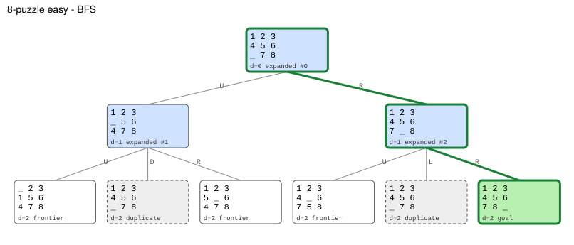
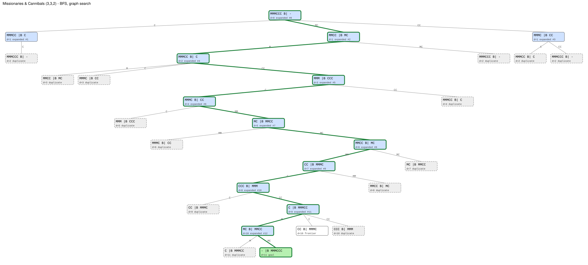
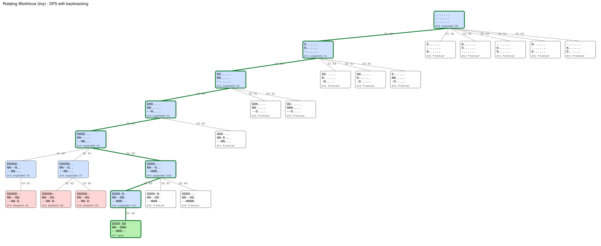

# Pjesa 4 — Search Trees: 8-Puzzle, Missionaries and Cannibals, Rotating Workforce Scheduling

**Lënda:** Inteligjenca Artificiale — Uninformed Search Techniques
**Kërkesa e detyrës:** të konstruktohet *Search Tree* për problemet 8-Puzzle, Missionaries and Cannibals dhe Rotating Workforce Scheduling.

## Skedarët

| Skedari | Përmbajtja |
|---|---|
| `search_core.py` | kërkimi i përgjithshëm (BFS, DFS, DLS, IDDFS, UCS) që **ndërton dhe ruan pemën**, si edhe eksporti i pemës në tekst, `.dot` dhe `.svg` |
| `eight_puzzle.py`, `missionaries.py`, `workforce.py` | modelimi i tre problemeve |
| `search_trees.py` | programi kryesor (CLI), krahasimi i algoritmeve dhe 16 teste automatike |
| `ui_search_trees.py` | vizatimi i pemës hap pas hapi (tkinter) |
| `trees/` | pemët e përdorura në këtë raport (`.svg` hapet në shfletues ose në VS Code) |
| `results/` | rezultatet e ekzekutimeve |

## Si ekzekutohet

```
cd search_trees
python search_trees.py --test
python search_trees.py missionaries --algorithm bfs --draw 40
python search_trees.py puzzle8 --instance medium --algorithm bfs --save
python search_trees.py puzzle8 --start "1 2 3 4 0 6 7 5 8" --algorithm iddfs
python search_trees.py workforce --instance small --algorithm dfs --save
python search_trees.py --export-trees
python search_trees.py --compare --save
python ui_search_trees.py
```

---

## 1. Çka është pema e kërkimit dhe si ndërtohet

Një **search tree** ka këto elemente:

- **Rrënja** është gjendja fillestare.
- Çdo **nyje** ruan një gjendje, prindin, veprimin që e krijoi, thellësinë d dhe koston g.
- **Fëmijët** e një nyjeje krijohen kur ajo **zgjerohet** (*expand*): për çdo veprim të lejuar krijohet një nyje e re.

Pema nuk është e njëjtë me hapësirën e gjendjeve. E njëjta gjendje mund të shfaqet shumë herë në pemë, nëse arrihet nga rrugë të ndryshme ose me cikle. Për këtë arsye programi ofron tri mënyra të trajtimit të gjendjeve të përsëritura:

| `--repeated` | Kuptimi |
|---|---|
| `none` | kërkim i pastër në pemë (*tree search*); çdo gjendje mund të përsëritet |
| `path` | një gjendje nuk lejohet dy herë në të njëjtën rrugë nga rrënja (pa cikle) |
| `graph` | asnjë gjendje nuk gjenerohet dy herë (*graph search*, bashkësia `reached`) |

Algoritmet e implementuara (të gjitha të painformuara):

| Algoritmi | Struktura e frontier-it | Goal test |
|---|---|---|
| **BFS** | radhë FIFO | kur gjenerohet nyja |
| **DFS** | stack LIFO | kur nyja nxirret nga stack-u |
| **DLS** | si DFS, por me limit thellësie | si DFS; nyjet në limit shënohen *cutoff* |
| **IDDFS** | DLS me L = 0, 1, 2, … | si DLS |
| **UCS** | radhë me prioritet sipas g | kur nyja zgjerohet (optimal) |

Gjatë kërkimit, çdo nyje ruan statusin e saj, dhe ky status përdoret për ngjyrat në figura:

| Statusi | Ngjyra | Kuptimi |
|---|---|---|
| `expanded #k` | blu | e zgjeruar; #k = radha e zgjerimit |
| `frontier` | e bardhë | e gjeneruar, ende e pazgjeruar |
| `duplicate` | gri, me vija | gjendje e përsëritur, e prerë |
| `cutoff` | vjollcë | limiti i thellësisë u arrit |
| `deadend` | rozë | nuk ka asnjë veprim të lejuar |
| `goal` | e gjelbër | gjendja qëllim |

Rruga deri te zgjidhja vizatohet me vija të trasha të gjelbra. Pemët ruhen në tri formate: tekst, Graphviz `.dot` dhe `.svg`. Formati `.svg` gjenerohet nga vetë programi dhe nuk kërkon asnjë paketë shtesë.

---

## 2. 8-Puzzle

### 2.1 Modelimi

| Elementi | Përkufizimi |
|---|---|
| State | 9 numra të lexuar rresht pas rreshti; 0 = vendi bosh. P.sh. `(1,3,6, 4,5,2, 0,7,8)` |
| Initial state | konfigurimi i dhënë |
| Goal state | `1 2 3 / 4 5 6 / 7 8 _` |
| Actions | lëviz vendin bosh **Up, Down, Left, Right**, në këtë rend; në cep ka 2 veprime, në anë 3, në qendër 4 |
| Transition | vendi bosh shkëmbehet me pllakën fqinje |
| Path cost | 1 për çdo lëvizje |
| Objective function | minimizo numrin e lëvizjeve deri te qëllimi |

### 2.2 Hapësira e gjendjeve (landscape)

- Ka 9! = 362 880 renditje të mundshme. Vetëm **181 440** (9!/2) mund ta arrijnë qëllimin.
- Një gjendje është e zgjidhshme vetëm nëse numri i inversioneve është çift. Programi e kontrollon këtë para kërkimit; testi `test_state_space_size` e verifikon me BFS mbi të gjithë hapësirën.
- Largësia maksimale nga qëllimi është **31** lëvizje.
- Faktori mesatar i degëzimit është rreth 2.67 (≈ 1.67 pa u kthyer te prindi).
- Pema pa kontroll të përsëritjeve është **e pafundme**, sepse çdo lëvizje mund të zhbëhet menjëherë.

Instancat e përdorura janë verifikuar me BFS mbi të gjithë hapësirën:

| Emri | Gjendja fillestare | Zgjidhja optimale |
|---|---|---|
| easy | `1 2 3 4 5 6 _ 7 8` | 2 |
| medium | `1 3 6 4 5 2 _ 7 8` | 8 |
| hard | `5 2 6 7 1 4 _ 3 8` | 16 |
| veryhard | `7 2 5 4 _ 8 6 3 1` | 24 |
| hardest | `8 6 7 2 5 4 3 _ 1` | 31 (maksimumi) |
| unsolvable | `1 2 3 4 5 6 8 7 _` | nuk ka zgjidhje (inversione tek) |

### 2.3 Pema e kërkimit

**BFS, easy:** pema e plotë deri te qëllimi (9 nyje).



Të njëjtat të dhëna në formë teksti (`trees/puzzle8_easy_bfs.txt`):

```
`-[1 2 3 | 4 5 6 | _ 7 8] d=0 E0 *
  |---U--> [1 2 3 | _ 5 6 | 4 7 8] d=1 E1
  | |---U--> [_ 2 3 | 1 5 6 | 4 7 8] d=2 open
  | |---D--> [1 2 3 | 4 5 6 | _ 7 8] d=2 dup
  | `---R--> [1 2 3 | 5 _ 6 | 4 7 8] d=2 open
  `---R--> [1 2 3 | 4 5 6 | 7 _ 8] d=1 E2 *
    |---U--> [1 2 3 | 4 _ 6 | 7 5 8] d=2 open
    |---L--> [1 2 3 | 4 5 6 | _ 7 8] d=2 dup
    `---R--> [1 2 3 | 4 5 6 | 7 8 _] d=2 GOAL *
```

Pemët e tjera të këtij problemi:

| Figura | Përmbajtja |
|---|---|
| `trees/puzzle8_medium_bfs.svg` | BFS medium: 45 nyjet e para dhe rruga prej 8 lëvizjesh |
| `trees/puzzle8_easy_iddfs.svg` | iteracioni i fundit i IDDFS (L = 2) |
| `trees/puzzle8_easy_dls4.svg` | DLS me limit 4; nyjet në thellësinë 4 janë *cutoff* |
| `trees/puzzle8_easy_dfs.svg` | DFS: zbret thellë në degën e parë dhe gjen një zgjidhje me 64 328 lëvizje |

---

## 3. Missionaries and Cannibals

### 3.1 Modelimi

| Elementi | Përkufizimi |
|---|---|
| State | (m, c, b) = misionarë në bregun e majtë, kanibalë në bregun e majtë, b = 1 nëse barka është majtas |
| Initial state | (M, C, 1), për problemin klasik (3, 3, 1) |
| Goal state | (0, 0, 0) |
| Actions | ngarkesa e barkës (dm, dc), me 1 ≤ dm + dc ≤ K; për K = 2: M, C, MM, MC, CC |
| Kufizimi | në asnjë breg misionarët nuk duhet të jenë më pak se kanibalët, kur atje ka të paktën një misionar |
| Path cost | 1 për çdo kalim |
| Objective function | minimizo numrin e kalimeve |

Në figura dhe në tekst, gjendja shkruhet si `MMCC  |B MC`: majtas kush është në bregun e majtë, djathtas kush është në bregun e djathtë, dhe B tregon anën ku është barka.

### 3.2 Hapësira e gjendjeve

| Instanca (M, C, K) | Kombinime (m, c, b) | Të vlefshme | Të arritshme | Zgjidhja optimale |
|---|---|---|---|---|
| classic (3, 3, 2) | 32 | 20 | 16 | 11 kalime |
| boat3 (3, 3, 3) | 32 | 20 | 18 | 5 |
| five (5, 5, 3) | 72 | 32 | 28 | 11 |
| impossible (4, 4, 2) | 50 | 26 | 11 | **nuk ka zgjidhje** |

Hapësira e gjendjeve është shumë e vogël (16 gjendje të arritshme), por **pema** pa kontroll të përsëritjeve është e pafundme: çdo kalim mund të kthehet mbrapsht menjëherë.

### 3.3 Pema e kërkimit

**BFS me graph search, problemi klasik.** Pema ka vetëm 29 nyje; zgjidhja prej 11 kalimesh është e shënuar me të gjelbër.



**BFS si tree search i pastër** (`trees/missionaries_bfs_tree.svg`, 40 nyjet e para). Këtu shihet si e njëjta gjendje rishfaqet vazhdimisht. Për të arritur thellësinë 11, BFS gjeneroi **11 878** nyje, krahasuar me 29 në graph search.

---

## 4. Rotating Workforce Scheduling (RWS)

### 4.1 Përshkrimi dhe modelimi

Në RWS ndërtohet një plan javor **ciklik**. Plani është një tabelë me n rreshta (n punonjës / javë) dhe 7 kolona (E hënë … E diel). Çdo qelizë është:

- `D` = turni i ditës,
- `N` = turni i natës,
- `-` = ditë pushimi.

Punonjësi 1 punon rreshtin 1 në javën e parë, rreshtin 2 në javën e dytë, e kështu me radhë; pas rreshtit n kthehet te rreshti 1. Prandaj plani lexohet si **një sekuencë ciklike** prej 7n ditësh. Ky është një version i vogël i problemit standard RWS (Musliu et al.).

**Kufizimet e instancave:**

1. **Kërkesa ditore:** në ditën j punojnë saktësisht demand[s][j] punonjës në turnin s.
2. **Sekuenca të ndaluara:** N → D (pas natës nuk lejohet turni i ditës pa pushim).
3. Çdo **bllok ditësh pune** ka gjatësi në [work_min, work_max].
4. Çdo **bllok pushimi** ka gjatësi në [off_min, off_max].
5. **Kufiri i turneve të njëjta:** të shumtën max_same[s] turne s radhazi.

Kufizimet 3–5 janë ciklike: fundi i rreshtit n vazhdon në rreshtin 1.

**Formulimi i kërkimit (një ditë = një nivel i pemës):**

| Elementi | Përkufizimi |
|---|---|
| State | kolonat e vendosura deri tani (col₀, …, col_{d−1}); çdo kolonë ka një turn për çdo rresht |
| Initial state | () — asgjë e vendosur |
| Actions | vendos ditën e radhës: cilët rreshta marrin D dhe cilët N, saktësisht sipas kërkesës; C(n, d_D) · C(n − d_D, d_N) mundësi |
| Backtracking | `actions()` kthen vetëm kolonat që nuk shkelin asnjë kufizim që mund të kontrollohet tashmë; kolona e 7-të pranohet vetëm nëse i gjithë plani ciklik është i vlefshëm (`violations() == []`) |
| Goal | 7 kolona dhe asnjë shkelje; të gjitha zgjidhjet janë në thellësinë 7 |
| Path cost | 1 për çdo ditë |
| Objective function | numri i shkeljeve f(plan) = 0. Variant optimizimi i mundshëm: minimizimi i shkeljeve të kufizimeve të buta |

### 4.2 Instancat dhe landscape

| Instanca | Punonjës n | Kërkesa (D, N) për ditë | Kufizime | Zgjedhje për ditë | Plane që plotësojnë kërkesën | 3^(7n) | Gjendje në thellësitë 0..7 | Zgjidhje |
|---|---|---|---|---|---|---|---|---|
| tiny | 3 | 1, 1 | punë 2–5, pushim 1–2 | 6 | 6⁷ = 279 936 | 1.05 × 10^10 | 1, 6, 24, 66, 180, 492, 1 290, 885 | 885 |
| small | 4 | 1, 1 | punë 2–4, pushim 2–3, N ≤ 3 | 12 | 12⁷ = 35 831 808 | 2.29 × 10^13 | 1, 12, 108, 324, 1 032, 2 424, 7 368, 2 188 | 2 188 |
| weekend | 5 | D: 2 (E hënë–E premte), 1 (fundjavë); N: 1 | punë 2–5, pushim 2–4, N ≤ 3 | 30 / 20 | 9.72 × 10^9 | 5.00 × 10^16 | 1, 30, 540, 2 130, 14 640, 66 300, 287 160, 46 330 | 46 330 |
| impossible | 3 | 1, 1 | punë 2–3, pushim 3–4 | 6 | 279 936 | 1.05 × 10^10 | 1, 6, 24, 42, 0, … | **0** |

Vërejtje për tabelën:

- Kolona "Zgjedhje për ditë" është C(n, d_D) · C(n − d_D, d_N).
- Kolona "Gjendje në thellësitë 0..7" jep numrin e gjendjeve konsistente në çdo nivel. Këto u numëruan me një kalim të plotë të pemës.
- Numri i zgjidhjeve përfshin edhe planet që ndryshojnë vetëm nga rrotullimi ciklik i rreshtave. Çdo plan ka n rrotullime ekuivalente.
- Krasitja është shumë e fortë. Për `weekend`, nga 9.72 × 10^9 plane që plotësojnë kërkesën, në nivelin 6 mbeten vetëm 287 160 gjendje konsistente.
- Instanca `impossible` dështon që në ditën e katërt: asnjë gjendje nuk mbijeton në nivelin 4.

### 4.3 Pema e kërkimit

**DFS me backtracking, instanca tiny.** Kjo pemë tregon qartë backtracking-un: në ditën 6, tri nyje janë rrugë qorre (rozë), kështu që DFS kthehet te nyja e ditës 5 dhe provon zgjedhjen tjetër (`D2 N3`), e cila të çon te qëllimi.



Plani i gjetur (validuar: VALID):

```
Week  Mo Tu We Th Fr Sa Su
   1   D  D  D  D  -  D  D
   2   N  N  -  -  D  N  N
   3   -  -  N  N  N  -  -
```

BFS mbi të njëjtën instancë (`trees/workforce_tiny_bfs.svg`) duhet të gjenerojë 2 060 nyje para se të arrijë nivelin 7, krahasuar me 26 për DFS.

---

## 5. Krahasimi i algoritmeve

> **Burimi i të dhënave:** `python search_trees.py --compare --save`, ekzekutuar më 29.10.2026 me Python 3.13 (Linux), në mjedisin cloud të Claude. Lidhja me kompjuterin e studentes u ndërpre gjatë kësaj pjese. Numrat e nyjeve janë deterministikë dhe duhet të dalin të njëjtë kur programi ekzekutohet lokalisht; kohët do të ndryshojnë. Limiti ishte 2 000 000 nyje dhe 60 s për çdo kërkim.

Shkurtimet në tabela: **L** = gjatësia e zgjidhjes (kosto); **Gjen.** = nyje të gjeneruara; **Zgj.** = nyje të zgjeruara; **Max F** = madhësia maksimale e frontier-it.

### 5.1 8-Puzzle

| Instanca | Algoritmi | Status | L | Gjen. | Zgj. | Max F |
|---|---|---|---|---|---|---|
| medium (8) | BFS graph | FOUND | **8** | 383 | 136 | 102 |
| medium | UCS graph | FOUND | **8** | 633 | 237 | 139 |
| medium | DFS graph | FOUND | 28 840 | 417 150 | 157 433 | 42 826 |
| medium | IDDFS path | FOUND | **8** | 898 | 320 | **8** |
| medium | BFS tree (none) | FOUND | **8** | 3 751 | 1 299 | 2 451 |
| hard (16) | BFS graph | FOUND | **16** | 16 171 | 5 925 | 3 449 |
| hard | IDDFS path | FOUND | **16** | 65 662 | 23 984 | **15** |
| hard | BFS tree | LIMIT | – | 2 000 000 | 691 633 | 1 308 366 |
| veryhard (24) | BFS graph | FOUND | **24** | 307 826 | 114 842 | 24 983 |
| veryhard | DFS graph | FOUND | 41 328 | 124 758 | 44 911 | 29 986 |
| veryhard | IDDFS path | LIMIT | – | 2 000 000 | 734 321 | 21 |
| hardest (31) | BFS graph | FOUND | **31** | 483 564 | 181 347 | 25 134 |
| hardest | UCS graph | FOUND | **31** | 483 837 | 181 438 | 25 134 |
| unsolvable | BFS / DFS / UCS graph | NO_SOLUTION | – | 483 841 | **181 440** | 24 054 – 42 913 |

### 5.2 Missionaries and Cannibals

| Instanca | Algoritmi | Status | L | Gjen. | Zgj. |
|---|---|---|---|---|---|
| classic | BFS graph | FOUND | **11** | 29 | 13 |
| classic | UCS graph | FOUND | **11** | 31 | 14 |
| classic | DFS graph | FOUND | 11 | 27 | 12 |
| classic | IDDFS path | FOUND | **11** | 305 | 136 |
| classic | BFS tree | FOUND | **11** | 11 878 | 5 124 |
| classic | DFS tree | LIMIT | – | 2 000 000 | 999 999 |
| five (5, 5, 3) | BFS graph | FOUND | **11** | 62 | 22 |
| five | DFS graph | FOUND | 13 (jo optimale) | 44 | 15 |
| five | BFS tree | FOUND | **11** | 212 305 | 67 317 |
| impossible (4, 4, 2) | BFS / DFS / UCS graph | NO_SOLUTION | – | 23 | 11 |
| impossible | IDDFS path | NO_SOLUTION | – | 159 | 69 |
| impossible | BFS tree / DFS tree | LIMIT | – | 2 000 000 | – |

### 5.3 Rotating Workforce Scheduling

| Instanca | Algoritmi | Status | Gjen. | Zgj. | Max F | Koha (s) |
|---|---|---|---|---|---|---|
| tiny | DFS | FOUND | **26** | 12 | 14 | 0.001 |
| tiny | BFS | FOUND | 2 060 | 773 | 1 290 | 0.05 |
| tiny | IDDFS | FOUND | 3 267 | 1 194 | 16 | 0.07 |
| small | DFS | FOUND | **75** | 46 | 37 | 0.006 |
| small | BFS | FOUND | 11 271 | 3 931 | 7 368 | 0.51 |
| small | IDDFS | FOUND | 17 302 | 6 004 | 37 | 0.72 |
| weekend | DFS | FOUND | **94** | 16 | 78 | 0.005 |
| weekend | BFS | FOUND | 370 803 | 83 648 | 287 160 | 22.7 |
| weekend | IDDFS | FOUND | 475 181 | 104 302 | 80 | 28.9 |
| weekend | UCS | LIMIT (60 s) | 384 000 | 168 254 | 287 160 | 60.8 |
| impossible | të gjithë | NO_SOLUTION | 73 – 185 | – | – | < 0.01 |

### 5.4 Interpretimi

1. **BFS, UCS dhe IDDFS gjejnë gjithmonë zgjidhjen më të shkurtër** kur kostoja e çdo hapi është 1: 8, 16, 24 dhe 31 lëvizje për 8-puzzle, dhe 11 kalime për M&C. Testet e verifikojnë këtë. **DFS nuk është optimal:**
   - për 8-puzzle gjen rrugë me dhjetëra mijë lëvizje (64 328 për instancën easy me 2 lëvizje);
   - për M&C "five" gjen 13 kalime në vend të 11.
2. **Gjendjet e përsëritura e ndryshojnë rrënjësisht madhësinë e pemës.**
   - M&C: BFS si graph search gjeneroi 29 nyje; si tree search 11 878; DFS tree search nuk mbaron kurrë, sepse lëviz para-mbrapa pafundësisht.
   - 8-puzzle hard: BFS graph mbaroi me 16 171 nyje, ndërsa BFS tree kaloi 2 milionë nyje pa e gjetur zgjidhjen.
3. **Memoria:**
   - IDDFS përdor frontier sa thellësia (8, 15, 21 nyje);
   - BFS ruan dhjetëra mijë nyje (25 134 për hardest);
   - BFS tree mbi 1.3 milionë.

   Kostoja e IDDFS-it është kohore: për 8-puzzle me thellësi ≥ 24 e kaloi limitin e nyjeve, sepse me kontroll vetëm të rrugës (pa bashkësi `reached`) ai i rigjeneron shumë herë gjendjet që arrihen me rrugë të ndryshme.
4. **Mungesa e zgjidhjes vërtetohet vetëm me graph search mbi hapësirë të fundme:**
   - 8-puzzle `unsolvable`: zgjerohen saktësisht 181 440 gjendje, pra gjysma tjetër e hapësirës;
   - M&C (4, 4, 2): 11 gjendje të arritshme, asnjëra qëllim;
   - me tree search, të njëjtat raste përfundojnë vetëm me `LIMIT_REACHED`.
5. **Në RWS të gjitha zgjidhjet janë në thellësinë 7 dhe ka shumë zgjidhje.** DFS me backtracking zbret drejt e në fund dhe gjen plan të vlefshëm pas 26 / 75 / 94 nyjeve. BFS dhe IDDFS duhet të ndërtojnë të gjitha nivelet 0–6, d.m.th. 287 160 gjendje në nivelin 6 për `weekend`. Ky është i njëjti fenomen si te Sudoku (pjesa 2) dhe Latin Square (pjesa 3).
6. **UCS = BFS kur kostot janë të barabarta,** por me kosto shtesë për radhën me prioritet dhe me goal test kur nyja zgjerohet. Prandaj UCS gjeneron pak më shumë nyje se BFS.

---

## 6. Kompleksiteti

Shënojmë:

- **b** = faktori i degëzimit;
- **d** = thellësia e zgjidhjes më të cekët;
- **m** = thellësia maksimale e pemës (mund të jetë ∞);
- **ℓ** = limiti i DLS-it.

| Algoritmi | Koha | Memoria | I plotë? | Optimal (kosto 1)? |
|---|---|---|---|---|
| BFS | O(b^d) | O(b^d) | po (b i fundëm) | po |
| UCS | O(b^(1 + ⌊C*/ε⌋)) | po aq | po | po |
| DFS | O(b^m) | O(b · m) | jo në pemë të pafundme; po me graph search mbi hapësirë të fundme | jo |
| DLS | O(b^ℓ) | O(b · ℓ) | vetëm nëse d ≤ ℓ | jo |
| IDDFS | O(b^d) | O(b · d) | po | po |

Për UCS, C* është kostoja optimale dhe ε kostoja minimale e një hapi.

Me vlerat e problemeve tona:

| Problemi | b | d | Hapësira |
|---|---|---|---|
| 8-puzzle | ≈ 2.67 | deri në 31 | 181 440 gjendje |
| M&C | ≤ 5 | 11 | 16 gjendje |
| RWS | 6 – 30 | gjithmonë 7 | hapësira kufizohet nga krasitja (seksioni 4.2) |

---

## 7. Testimi

`python search_trees.py --test` ekzekuton 16 teste:

- **8-puzzle:**
  - hapësira ka 181 440 gjendje dhe largësia maksimale është 31;
  - thellësitë e deklaruara të instancave janë të sakta, dhe zgjidhshmëria përputhet me paritetin e inversioneve;
  - BFS dhe UCS janë optimale;
  - IDDFS është optimal dhe përdor limitet 0..d;
  - rruga e gjetur nga DFS përbëhet vetëm nga veprime të ligjshme dhe mbaron te qëllimi;
  - rasti pa zgjidhje zgjeron saktësisht 181 440 gjendje.
- **M&C:**
  - 20 gjendje të vlefshme;
  - 11 kalime me BFS (graph dhe tree), IDDFS dhe UCS;
  - çdo gjendje në rrugë është e sigurt;
  - (4, 4, 2) jep `NO_SOLUTION`;
  - DFS tree search ndalet vetëm nga limiti.
- **RWS:**
  - instancat tiny, small dhe weekend kanë zgjidhje, ndërsa `impossible` jep `NO_SOLUTION`;
  - çdo plan i gjetur kalon `violations() == []` dhe ka 7 hapa;
  - BFS gjen plan të vlefshëm;
  - validimi zbulon plane të gabuara.
- **Pema:** eksporti në tekst, DOT dhe SVG funksionon; konfigurimi i gabuar refuzohet.

---

## 8. Kufizimet dhe përfundimi

**Kufizimet:**

- Instancat e RWS janë të vogla krahasuar me benchmark-et reale, ku ka deri në dhjetëra punonjës dhe tre turne. Për ato, kërkimi i painformuar nuk shkallëzohet.
- Simetria e rrotullimit të rreshtave në RWS nuk është shfrytëzuar; çdo plan numërohet n herë.
- IDDFS me kontroll vetëm të rrugës është i ngadaltë për 8-puzzle me thellësi të madhe.
- Figurat tregojnë vetëm nyjet e para dhe rrugën e zgjidhjes, sepse pemët e plota kanë qindra mijëra nyje.

**Përfundimi:** për të tre problemet u modeluan gjendja, gjendja fillestare, qëllimi, veprimet, kostoja dhe funksioni objektiv. U ndërtuan dhe u vizatuan pemët e kërkimit me pesë algoritme të painformuara. Rezultatet tregojnë:

- BFS, UCS dhe IDDFS janë optimale por kushtojnë në memorie ose në kohë;
- DFS është i shpejtë kur ka shumë zgjidhje në të njëjtën thellësi (RWS), por nuk është optimal dhe mund të humbasë në degë shumë të thella (8-puzzle);
- trajtimi i gjendjeve të përsëritura (graph search) është vendimtar: ai e kthen një pemë të pafundme në kërkim të fundëm dhe lejon vërtetimin e mungesës së zgjidhjes.

---

## Referenca

- S. Russell, P. Norvig, *Artificial Intelligence: A Modern Approach*, kapitulli 3 (Solving Problems by Searching).
- N. Musliu, J. Gärtner, W. Slany, *Efficient generation of rotating workforce schedules*, Discrete Applied Mathematics (2002).
- A. Reinefeld, *Complete Solution of the Eight-Puzzle and the Benefit of Node Ordering in IDA\** (1993) — 181 440 gjendje, maksimumi 31 lëvizje.
